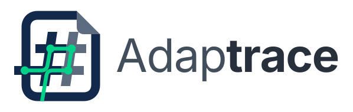

<h1>
  <picture>
    <source media="(prefers-color-scheme: dark)" srcset="docs/images/logo/adaptrace-logo-dark.svg">
    
  </picture>
</h1>

[日本語](README.md) | English

**Decide with agility. Trace every change.**

Adaptrace is a tool for managing a project's requirements, decisions, tasks and risks, and the dependencies between them.
All data is stored as Markdown files that conform to the [Open Knowledge Format (OKF)](https://github.com/GoogleCloudPlatform/knowledge-catalog/tree/main/okf).
People and AI agents read and write the same information.
The goal is to know right away which documents to review when something changes.

> **Status: v1.0.0**
> Every command under "Usage" below works. The data format and the commands change according to [Semantic Versioning](https://semver.org/). A change that breaks compatibility raises the major version.
> The npm package is not published yet.
>
> The Japanese README is the original. This English version follows it (ADR-003). The specification and the guides have English versions too. The decision records (`.adaptrace/`) and the skills are in Japanese.

---

## Why Adaptrace

In agile development, decisions change quickly as requests change.
Traditional system development processes, on the other hand, are rigid. Contracts, requirements specifications, baselines and change control procedures assume that what was decided stays the same.

Until now, the gap between the two has been filled by people: system integrators and project managers adjusting things by hand.
Each time a decision changed, they found the documents it reached, asked for reviews and kept the records.
With AI agents, much of that work can now be delegated.
At the same time, customers expect value that is more advanced, more flexible and delivered faster.

When development contracts move from billing by the person-month to billing by outcome, a change of scope stops being revenue and becomes a cost.
What matters then is a way to learn the following quickly and cheaply:

- Which requirements, designs, tasks and tests does this change reach?
- What exactly needs to be reviewed?
- On what grounds do we accept the change, accept it for an extra fee, or decline it?

Adaptrace connects flexible decision-making (requests, agreements, decisions) with rigid development processes.
It records requirements and decisions as typed documents and the dependencies between them.
When a decision changes, you can trace right away which documents to review, and whether the review is done.

### Where the name comes from

"Adaptrace" is a coined word that combines adapt and trace.

- **adapt**: changing decisions flexibly as requests and circumstances change
- **trace**: keeping track of which requirements, designs, tasks and tests each change reached

It stands for what this tool does: you can change decisions in an agile way without breaking the change tracking that traditional development processes require.
The project was formerly named "Accordant". It was renamed before publication because a developer tool with the same name exists (ADR-036).

## Features

- **OKF native**: all data is Markdown with frontmatter. Frontmatter is the block of YAML fields at the top of a file. Nothing is locked into a particular service, and Git can track and review the changes.
- **Typed documents**: requirements, decisions, tasks, risks, milestones, change requests and more are told apart by `type`.
- **Directed dependencies**: keys such as `depends_on` and `satisfies` give each link between documents a direction and a meaning.
- **Impact analysis**: when a document changes, Adaptrace follows the documents that depend on it and lists the ones to review.
- **Staleness detection**: it finds documents older than what they depend on and marks them "needs review".
- **AI agent integration**: AI agents such as Claude Code read and write the documents through the CLI or MCP. The CLI is the command-line tool. MCP is a protocol that lets AI agents use external tools. Agents can judge the impact of a change and draft updates.
- **Backlog.md integration**: tasks use the same format as [Backlog.md](https://github.com/MrLesk/Backlog.md), and the two convert both ways.

## Data model

### Document types

| `type` | Content |
|---|---|
| `Requirement` | Requirements and customer requests |
| `Acceptance` | Acceptance criteria and definitions of done |
| `Decision` | Records of decisions (like ADRs) |
| `Task` | Work items |
| `Risk` | Risks and their responses |
| `Milestone` | Milestones |
| `Change Request` | Change requests |
| `Meeting` | Meeting minutes |

An ADR (architecture decision record) is a format for recording design decisions.
Types are not fixed: each project can add its own, following OKF's approach.

Progress (`in_progress` and so on) is written in `state`.
`status` is used only for the OKF lifecycle (`draft` / `stable` / `deprecated`).
The last update is recorded in OKF 0.2's `generated: { by, at }`.
See [docs/spec/schema.en.md](docs/spec/schema.en.md) for details.

### Dependency keys

Dependencies are written as keys in a document's frontmatter. In the table, "the target document" is the document written as the key's value.

| Key | Meaning | How a change travels |
|---|---|---|
| `depends_on` | This document depends on the target document | When the target document changes, review this document |
| `derived_from` | This document was derived from the target document | When the target document changes, review this document |
| `satisfies` | This document satisfies the target document (a requirement, for example) | When the target document changes, review this document |
| `blocks` | The target document cannot proceed until this document is done | When this document is late, the target document is affected |
| `supersedes` | This document replaces the target document | The target document is no longer valid |
| `changes` | This change request changes the target document | Not passed on (once approved, the target document gets the request in `derived_from`) |


The value is a list of document paths. Paths start with `/` (`/requirements/security-mfa.md`) and are called bundle-absolute paths.
A bundle is the folder that holds Adaptrace's documents.
Ordinary Markdown links in the body are treated as references, kept apart from dependencies.

### Order of work and deadlocks

Besides review, `depends_on` and `blocks` also express **the order of work**: which document waits for which. The two keys wait in opposite directions.

| What you write | Who waits |
|---|---|
| `depends_on: B` in A | A waits for B. A cannot proceed until B is done |
| `blocks: B` in A | B waits for A. B cannot proceed until A is done |

`adaptrace board` marks a waiting task with `waiting for`.

Documents that wait for each other are in a **deadlock**: neither piece of work can start.

```text
tasks/a.md: depends_on: /tasks/b.md   -> A waits for B
tasks/a.md: blocks: /tasks/b.md       -> B waits for A
```

`adaptrace validate` warns about a deadlock. It is a warning, not an error, because it can happen for a while in the middle of planning. To resolve it, remove one of the dependencies, or split the work so that part of it can start first.

### Example: a Task document

This is an example of `tasks/task-042-mfa-login.md` in the bundle. The task satisfies the requirement for multi-factor authentication, and depends on the decision that chose the authentication provider (ADR-012).

```markdown
---
type: Task
title: Add multi-factor authentication to the login screen
state: in_progress
owner: tanaka
due: 2026-12-15
generated: { by: human:tanaka, at: 2026-10-29T10:00:00+09:00 }
satisfies:
  - /requirements/security-mfa.md
depends_on:
  - /decisions/adr-012-auth-provider.md
---

# Add multi-factor authentication to the login screen

Uses the authentication provider chosen in [ADR-012](../decisions/adr-012-auth-provider.md)
to satisfy [the requirement: multi-factor authentication](../requirements/security-mfa.md).
```

### Bundle layout of the example

This is the layout of a bundle that contains the Task document above. The bundle goes in `.adaptrace/` at the root of the project's repository, with a directory for each type.

```text
.adaptrace/
├── index.md                       # Table of contents (OKF reserved file)
├── log.md                         # Change log, newest first (OKF reserved file)
├── requirements/
│   ├── index.md
│   └── security-mfa.md            # Requirement: MFA (the example Task points to it with satisfies)
├── decisions/
│   ├── index.md
│   └── adr-012-auth-provider.md   # Decision: authentication provider (the example Task points to it with depends_on)
├── tasks/
│   ├── index.md
│   └── task-042-mfa-login.md      # The example Task document above
└── risks/
    ├── index.md
    └── risk-007-vendor-lockin.md  # Risk: lock-in to the authentication provider
```

## Installation

Adaptrace runs on [Bun](https://bun.sh/). Install Bun, then install Adaptrace directly from GitHub. It is not published on npm. Without Bun, use "Download an executable" below.

```bash
bun add -g github:yutaponium/Adaptrace#v1.0.0
adaptrace --version
```

This gives you the `adaptrace` command. To move to a newer version, change the tag after `#` and run the same command.

**Download an executable** (no Bun needed)

From [Releases](https://github.com/yutaponium/Adaptrace/releases), download the file for your platform (`adaptrace-<version>-<platform>.tar.gz`, or `.zip` for Windows). The platforms are `linux-x64`, `linux-arm64`, `darwin-arm64` (Apple silicon), `darwin-x64` (Intel Mac) and `windows-x64`. You can check the file with `SHA256SUMS` on the same page. The Linux builds use glibc, so they do not run on musl systems such as Alpine Linux.

Extracting it creates a folder with the same name. Put the `adaptrace` inside (`adaptrace.exe` on Windows) in a folder on your PATH.

```bash
tar -xzf adaptrace-v1.0.0-linux-x64.tar.gz
sudo mv adaptrace-v1.0.0-linux-x64/adaptrace /usr/local/bin/
adaptrace --version
```

The executables are not signed. On macOS, run `xattr -d com.apple.quarantine adaptrace-v1.0.0-darwin-arm64/adaptrace` before you move it, because a file downloaded with a browser does not open as it is. If Windows shows a warning, choose "More info" and run it.

You can also use a clone of the repository. In that case, read `adaptrace` in this README as `bun <your clone>/src/cli.ts`.

```bash
git clone https://github.com/yutaponium/Adaptrace.git ~/tools/adaptrace
cd ~/tools/adaptrace
git checkout v1.0.0
bun install
```

## Usage

Run the Adaptrace commands at the root of the repository of the project you want to manage. The documents go in `.adaptrace/` (the bundle) of that repository.

### Getting started

```bash
cd my-project

# Create the bundle (.adaptrace/). Existing files are never overwritten
adaptrace init

# Check OKF conformance and dependencies (frontmatter, broken targets, cycles and more)
adaptrace validate
```

How to bring in existing requirements and design documents is in [the adoption guide](docs/guide/adoption.en.md).

### Main commands

```bash
# Show what a change to a requirement reaches
adaptrace impact requirements/security-mfa.md

# Order them upstream first, so no document is reviewed twice
adaptrace impact requirements/security-mfa.md --order review

# Have an LLM judge whether each affected document needs a change, and draft updates (writes no files)
adaptrace assess requirements/security-mfa.md --llm "claude -p"

# Draft decisions, tasks and risks from meeting minutes (--write creates the new files only)
adaptrace extract meetings/2026-10-01-kickoff.md --llm "claude -p"

# What a change request reaches (tasks, owners, work to redo, milestones at risk), with an LLM's effort estimate
adaptrace estimate requirements/security-mfa.md --request change-requests/cr-001-sms.md --llm "claude -p"

# How far the review for a change request has gone (fails in CI until all are reviewed; succeeds when no document points at the request yet)
adaptrace progress change-requests/cr-001-sms.md

# List documents older than what they depend on
adaptrace stale

# Suggest how to tidy the dependencies (dependencies on deprecated documents, redundant dependencies, orphans)
adaptrace health

# Pairs of open change requests whose reach overlaps (material for discussing whether they conflict)
adaptrace conflicts

# Prepare a meeting about overlapping change requests (participants, agenda, a Meeting draft; with --llm, an invitation too)
adaptrace meeting change-requests/cr-001-sms.md change-requests/cr-002-email.md

# A table of risks (saved as CSV, it opens in Excel and the like)
adaptrace list --type Risk --columns state,probability,impact,owner --format markdown

# For a bundle that relied on git dates: write each document's last commit date into generated (once; --write writes)
adaptrace migrate-dates

# Print the dependency graph as Mermaid
adaptrace graph --format mermaid

# Convert tasks to and from Backlog.md (--write writes)
adaptrace sync --backlog backlog --write

# Show tasks as a kanban board
adaptrace board

```

An LLM (large language model) is an AI that generates text.
`--llm` takes a command that calls an LLM.

Example output of `adaptrace impact`:

```text
requirements/security-mfa.md was updated 2026-10-29T10:00:00+09:00 (generated.at)

Direct (2)
  tasks/task-042-mfa-login.md  satisfies  updated 2026-10-20T09:00:00+09:00 (generated.at)  needs review
  acceptance/mfa-acceptance.md  derived_from  updated 2026-10-18T15:30:00+09:00 (generated.at)  needs review

Indirect (1)
  tasks/task-051-mfa-e2e-test.md  depends_on -> tasks/task-042-mfa-login.md  updated 2026-10-30T11:00:00+09:00 (generated.at)

2 documents to review
```

The last update comes from `generated.at`. Documents without `generated` cannot be compared, and `adaptrace validate` warns about them.
Documents older than the changed document are marked `needs review`.

How to bring Adaptrace into an existing repository is in [docs/guide/adoption.en.md](docs/guide/adoption.en.md).
How to use it for project management is in [docs/guide/project-management.en.md](docs/guide/project-management.en.md).
It covers estimating the impact of change requests, regular status checks, replacing decisions and more.

## Adding the MCP server to a coding agent

The Adaptrace CLI also runs as an MCP server. MCP is a protocol that lets AI agents use external tools.
Once you register it with a coding agent, the agent can read the bundle, find the documents to review and draft updates.

- The agent finds the documents to review with `impact`, `progress` and `stale`
- It gets what changed upstream from `assess_context`, and a draft update from `propose_update`. Each draft comes with the problems the change would add and remove
- The MCP server writes no files. A person, or the agent's own editing tools, applies the changes

For every agent, the command to register is `adaptrace mcp .adaptrace`. `.adaptrace` is the bundle's location from the project root. If you use a clone, replace `adaptrace` with `bun <your clone>/src/cli.ts`.

The ways to register below were checked in each agent's official documentation as of November 2026. Adaptrace has been tested only with Claude Code.

| Agent | How to register | Official documentation |
|---|---|---|
| Claude Code | `claude mcp add` | [MCP](https://code.claude.com/docs/en/mcp) |
| OpenAI Codex CLI | `codex mcp add`, or `.codex/config.toml` | [MCP](https://learn.chatgpt.com/docs/extend/mcp?surface=cli) |
| Gemini CLI | `gemini mcp add` | [MCP servers](https://geminicli.com/docs/tools/mcp-server/) |
| Google Antigravity | Edit `.agents/mcp_config.json` | [MCP](https://antigravity.google/docs/mcp) |
| GitHub Copilot CLI | `copilot mcp add` | [Adding MCP servers](https://docs.github.com/en/copilot/how-tos/copilot-cli/customize-copilot/add-mcp-servers) |
| Cursor | Edit `.cursor/mcp.json` | [MCP](https://cursor.com/docs/context/mcp) |

### Claude Code

```bash
claude mcp add adaptrace -- adaptrace mcp .adaptrace
```

By default, only you can use it, in this project. With `--scope project`, it is written to `.mcp.json` at the project root, so the team can share it.

### OpenAI Codex CLI

```bash
codex mcp add adaptrace -- adaptrace mcp .adaptrace
```

To write it in a configuration file, use `~/.codex/config.toml` (for yourself) or the project's `.codex/config.toml`.

```toml
[mcp_servers.adaptrace]
command = "adaptrace"
args = ["mcp", ".adaptrace"]
```

### Gemini CLI

```bash
gemini mcp add adaptrace adaptrace mcp .adaptrace
```

By default, it is written to the project's `.gemini/settings.json`. With `--scope user`, it is written to `~/.gemini/settings.json`.

### Google Antigravity

There is no command to add an MCP server. Write it in the project's `.agents/mcp_config.json` (or `~/.gemini/config/mcp_config.json` to use it in all projects). In the `agy` CLI, you can also manage it with `/mcp`.

```json
{
  "mcpServers": {
    "adaptrace": {
      "command": "adaptrace",
      "args": ["mcp", ".adaptrace"]
    }
  }
}
```

### GitHub Copilot CLI

```bash
copilot mcp add adaptrace -- adaptrace mcp .adaptrace
```

It is added to `~/.copilot/mcp-config.json`. To share it with the team, write it in the project's `.github/mcp.json`.

### Cursor

Write the same JSON as for Antigravity in the project's `.cursor/mcp.json` (or `~/.cursor/mcp.json` to use it in all projects).

## Adding the skills

Adaptrace has eight skills that teach an AI agent the steps of a task. The skills follow the open [Agent Skills](https://agentskills.io/) format.

> **The skills are tested only with Claude Code.** How they work with other agents has not been checked. The skills also contain instructions that assume Claude Code features (such as a tool that asks questions with choices). The skills are written in Japanese; English reference translations are in [docs/skills/](docs/skills/).

### Claude Code

You can install all eight skills together as a Claude Code plugin.

```text
/plugin marketplace add yutaponium/Adaptrace
/plugin install adaptrace@adaptrace
```

The skill names get the prefix `adaptrace:` (for example `/adaptrace:adaptrace-adopt`).
Without the plugin, you can copy the directories in `skills/` to the project's `.claude/skills/` (or `~/.claude/skills/` to use them in all projects). The details are in [the adoption guide](docs/guide/adoption.en.md#have-claude-code-help-you-bring-in-files).

### Other coding agents

Copy the `skills/adaptrace-*` directories of a clone to where each agent reads skills. The locations below were checked in the official documentation as of November 2026. Many agents read the shared `.agents/skills/`.

| Agent | Project location | Personal location | Official documentation |
|---|---|---|---|
| OpenAI Codex CLI | `.agents/skills/` | `~/.agents/skills/` | [Skills](https://learn.chatgpt.com/docs/build-skills) |
| Gemini CLI | `.agents/skills/` or `.gemini/skills/` | `~/.agents/skills/` or `~/.gemini/skills/` | [Skills](https://geminicli.com/docs/cli/skills/) |
| Google Antigravity | `.agents/skills/` | `~/.gemini/config/skills/` | [Skills](https://antigravity.google/docs/skills) |
| GitHub Copilot CLI | `.agents/skills/` or `.github/skills/` | `~/.agents/skills/` or `~/.copilot/skills/` | [Adding skills](https://docs.github.com/en/copilot/how-tos/copilot-cli/customize-copilot/add-skills) |
| Cursor | `.agents/skills/` or `.cursor/skills/` | `~/.agents/skills/` or `~/.cursor/skills/` | [Skills](https://cursor.com/docs/context/skills) |

```bash
mkdir -p .agents/skills
cp -r ~/tools/adaptrace/skills/adaptrace-* .agents/skills/
```

Distribution as plugins or extensions for each agent will be considered later.

### List of skills

Every skill works in a conversation with you. It changes files only after you approve the diff.

| Work | Skill | English reference |
|---|---|---|
| Bring existing files into the bundle and add dependencies. How to use it is in [the adoption guide](docs/guide/adoption.en.md#have-claude-code-help-you-bring-in-files) | `adaptrace-adopt` ([skills/adaptrace-adopt/](skills/adaptrace-adopt/SKILL.md)) | [adaptrace-adopt.en.md](docs/skills/adaptrace-adopt.en.md) |
| Take a request received by e-mail or chat as a change request | `adaptrace-change-request` ([skills/adaptrace-change-request/](skills/adaptrace-change-request/SKILL.md)) | [adaptrace-change-request.en.md](docs/skills/adaptrace-change-request.en.md) |
| Record the decision to approve, reject or defer change requests, and show the overlapping change requests and the next steps | `adaptrace-change-decision` ([skills/adaptrace-change-decision/](skills/adaptrace-change-decision/SKILL.md)) | [adaptrace-change-decision.en.md](docs/skills/adaptrace-change-decision.en.md) |
| Review the documents an approved change request reaches, upstream first | `adaptrace-review` ([skills/adaptrace-review/](skills/adaptrace-review/SKILL.md)) | [adaptrace-review.en.md](docs/skills/adaptrace-review.en.md) |
| Before a regular meeting, sum up the status and draft an agenda | `adaptrace-weekly` ([skills/adaptrace-weekly/](skills/adaptrace-weekly/SKILL.md)) | [adaptrace-weekly.en.md](docs/skills/adaptrace-weekly.en.md) |
| Create documents from meeting minutes, and record what was decided in existing ones | `adaptrace-minutes` ([skills/adaptrace-minutes/](skills/adaptrace-minutes/SKILL.md)) | [adaptrace-minutes.en.md](docs/skills/adaptrace-minutes.en.md) |
| Replace a decision with a new one, and settle the documents that depended on the old one | `adaptrace-supersede` ([skills/adaptrace-supersede/](skills/adaptrace-supersede/SKILL.md)) | [adaptrace-supersede.en.md](docs/skills/adaptrace-supersede.en.md) |
| Check the health of the dependencies, and tidy dependencies on deprecated documents, redundant dependencies, orphans, deadlocks and more | `adaptrace-health` ([skills/adaptrace-health/](skills/adaptrace-health/SKILL.md)) | [adaptrace-health.en.md](docs/skills/adaptrace-health.en.md) |

## Roadmap

1. **v0.1**: schema definition, OKF conformance checks, backlinks and the dependency graph
2. **v0.2**: impact analysis (`impact`) and staleness detection (`stale`)
3. **v0.3**: conversion to and from Backlog.md tasks, and a kanban view
4. **v0.4**: agent integration through an MCP server
5. **v0.5**: LLM judgment of impact (whether, and how much, a review is needed) and draft updates
6. **v0.6**: creating a bundle (`init`), and extracting decisions and tasks from meeting minutes
7. **v0.7**: support for estimating the cost of change requests
8. **v0.8**: change management support (review order and progress, review records, detecting changes to non-Markdown files, discussing overlapping change requests)
9. **v0.9**: AI agent skills for the work (bringing in existing files, taking change requests, reviewing, preparing regular meetings, taking in minutes)
10. **v1.0**: the remaining skills (replacing decisions, bundle health checks), the rename (from Accordant), and publishing the repository

Everything through v1.0 is implemented and released as v1.0.0. Up to v0.9.0, the project was released under the name Accordant.

## Non-goals

- Relying on a proprietary database or a cloud service. The data is always plain Markdown
- Fully replacing requirements management tools for regulated industries (such as DOORS or Jama Connect)
- Depending on a particular LLM or AI agent

## About OKF and Backlog.md

- Adaptrace is a community project that follows the OKF specification. It is not affiliated with Google or Google Cloud, and it is not an official implementation.
- The task management part uses the same format as [Backlog.md](https://github.com/MrLesk/Backlog.md), published under the MIT License. Adaptrace neither forks nor depends on it. If code is ever taken from it, Backlog.md's copyright notice and license will be kept in [THIRD_PARTY_NOTICES.md](THIRD_PARTY_NOTICES.md).

## Contributing

Ideas and discussion in Issues are welcome.
We would like to hear your views on topics such as:

- How to design document types and dependency keys
- How to make impact analysis more accurate
- The problems you face when managing changes in real projects

## License

[MIT License](LICENSE)

The name "Adaptrace" and its logo are not covered by the MIT License. The policy for using them is in [TRADEMARKS.en.md](TRADEMARKS.en.md).
