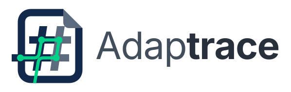

<h1>
  <picture>
    <source media="(prefers-color-scheme: dark)" srcset="docs/images/logo/adaptrace-logo-dark.svg">
    
  </picture>
</h1>

日本語 | [English](README.en.md)

**意思決定はアジャイルに。変更の追跡は確実に。**

Adaptraceは、プロジェクトの要件・意思決定・タスク・リスクと、それらの依存関係を管理するツールです。
データはすべて、[Open Knowledge Format（OKF）](https://github.com/GoogleCloudPlatform/knowledge-catalog/tree/main/okf)
に準拠したMarkdownファイルとして保存します。
人とAIエージェントが、同じ情報を読み書きできます。
何かが変わったときに、どの文書を見直せばよいかをすぐに把握できることを目指しています。

> **ステータス：v1.0.0**
> 下の「使い方」にあるコマンドは、すべて使えます。ただし、`coverage` はv1.0.0の次のリリースから使えます。データの形式とコマンドは、[Semantic Versioning](https://semver.org/lang/ja/) に従って変えます。互換性を崩すときは、メジャーバージョンを上げます。
> npmのパッケージは、まだ公開していません。

---

## なぜAdaptraceか

アジャイルな開発では、要望の変化に合わせて、判断を素早く変えます。
一方、旧来のシステム開発のプロセスは、硬くできています。契約、要件定義書、ベースライン、変更管理の手続きは、決めたことが変わらない前提で組まれています。

これまで、この二つの間を埋めてきたのは、SIerやPMによる人手の調整でした。
判断が変わるたびに、どの文書に波及するかを調べ、見直しを頼み、記録を残してきました。
AIエージェントの登場で、その多くを任せられるようになりつつあります。
その一方で、顧客からは、より高度で、より柔軟で、より速い価値の提供が求められています。

開発の契約が人月から成果ベースへ移ると、スコープの変更は売上ではなくコストになります。
そこで重要になるのは、次のことを安く速く把握できる仕組みです。

- この変更は、どの要件・設計・タスク・テストに波及するのか
- 見直しが必要なのは、どこからどこまでか
- 変更を受け入れるか、追加の費用で受けるか、断るかを判断する根拠は何か

Adaptraceは、柔軟な意思決定（要望・合意・判断）と、硬い開発プロセスをつなぎます。
要件や判断を、型の付いた文書と、文書どうしの依存関係として記録します。
判断を変えても、どの文書を見直せばよいか、見直しが済んだかを、すぐに追跡できます。

### 名前の由来

「Adaptrace」は、adapt（適応する）とtrace（追跡する）を組み合わせた造語です。

- **adapt**：要望や状況の変化に合わせて、判断を柔軟に変えること
- **trace**：その変化が、どの要件・設計・タスク・テストに波及したかを、たどれる状態に保つこと

判断をアジャイルに変えても、旧来の開発プロセスが求める変更の追跡を崩さない、というこのツールの役目を表しています。
以前は「Accordant」という名前でした。同じ名前の開発者向けのツールがあるため、公開の前に変えました（ADR-036）。

## 特徴

- **OKFネイティブ**：データはすべて、フロントマター付きのMarkdownです。フロントマターは、ファイルの先頭にYAML形式で書く項目の欄です。特定のサービスに閉じ込められず、Gitで差分の管理やレビューができます。
- **型付きの文書**：要件、意思決定、タスク、リスク、マイルストーン、変更要求などを `type` で区別します。
- **向きのある依存関係**：`depends_on` や `satisfies` などのキーで、文書どうしのつながりに向きと意味を持たせます。
- **影響分析**：ある文書が変わったとき、その文書に依存している文書をたどり、見直す候補を列挙します。
- **陳腐化の検出**：依存先より古いまま更新されていない文書を見つけ、「要確認」の印を付けます。
- **AIエージェントとの連携**：Claude CodeなどのAIエージェントが、CLIやMCPを通じて文書を読み書きできます。CLIは、コマンドで操作する道具です。MCPは、AIエージェントが外部の道具を使うための仕組みです。エージェントは、影響の判定や更新案の作成を担えます。
- **Backlog.mdとの連携**：タスクの形式を [Backlog.md](https://github.com/MrLesk/Backlog.md) に合わせ、相互に変換できます。

## データモデル

### 文書の型

| `type` | 内容 |
|---|---|
| `Requirement` | 要件・顧客の要望 |
| `Acceptance` | 受け入れ基準・成果の定義 |
| `Decision` | 意思決定の記録（ADRに相当） |
| `Task` | 作業項目 |
| `Risk` | リスクと対応策 |
| `Milestone` | マイルストーン |
| `Change Request` | 変更要求 |
| `Meeting` | 議事録 |

ADRは、設計上の意思決定を記録する文書の形式です。
型は固定ではなく、プロジェクトごとに追加できます。これはOKFの方針に従ったものです。

進み具合（`in_progress` など）は `state` で表します。
`status` は、OKFのライフサイクル（`draft` / `stable` / `deprecated`）にだけ使います。
最終更新は、OKF 0.2の `generated: { by, at }` で記録します。
詳しくは [docs/spec/schema.md](docs/spec/schema.md) を参照してください。

### 依存関係のキー

依存関係は、文書のフロントマターにキーで書きます。表の「依存先の文書」は、キーの値に書いた文書です。

| キー | 意味 | 影響の向き |
|---|---|---|
| `depends_on` | この文書は依存先の文書に依存している | 依存先の文書が変わったら、この文書を見直す |
| `derived_from` | この文書は依存先の文書から導かれた | 依存先の文書が変わったら、この文書を見直す |
| `satisfies` | この文書は依存先の文書（要件など）を満たす | 依存先の文書が変わったら、この文書を見直す |
| `blocks` | この文書が終わらないと依存先の文書が進めない | この文書が遅れたら、依存先の文書に影響する |
| `supersedes` | この文書は依存先の文書を置き換える | 依存先の文書は無効になる |
| `changes` | この変更要求は依存先の文書を変える | 伝えない（承認したら、依存先の文書に `derived_from` で変更要求を追加する） |

値は、文書のパスのリストです。パスは `/` で始めます（`/requirements/security-mfa.md`）。これをバンドル絶対パスと呼びます。
バンドルは、Adaptraceの文書をまとめて置くフォルダです。
本文中の通常のMarkdownリンクは「参照」として扱い、依存関係とは区別します。

### 作業の順序とデッドロック

`depends_on` と `blocks` は、見直しの関係に加えて、**作業の順序**も表します。どの文書がどの文書を待つか、という関係です。待つ向きは、2つのキーで逆になります。

| 書き方 | 待つのは |
|---|---|
| Aに `depends_on: B` と書く | AがBを待つ。Bが終わるまで、Aは進めない |
| Aに `blocks: B` と書く | BがAを待つ。Aが終わるまで、Bは進めない |

`adaptrace board` は、待っているタスクに `waiting for` を付けて示します。

文書どうしが互いに待っている状態を、**デッドロック**と呼びます。どちらの作業も始められません。

```text
tasks/a.md：depends_on: /tasks/b.md   → AはBを待つ
tasks/a.md：blocks: /tasks/b.md       → BはAを待つ
```

`adaptrace validate` は、デッドロックを警告します。計画の途中では一時的に起こりうるので、エラーではなく警告です。依存関係を1つ外すか、作業を分けて一部を先に始められるようにすると、解消します。

### 例：Taskの文書

バンドルの中の `tasks/task-042-mfa-login.md` の例です。多要素認証の要件を満たし、認証基盤を決めた判断（ADR-012）に依存するタスクです。

```markdown
---
type: Task
title: ログイン画面に多要素認証を追加する
state: in_progress
owner: tanaka
due: 2026-12-15
generated: { by: human:tanaka, at: 2026-10-29T10:00:00+09:00 }
satisfies:
  - /requirements/security-mfa.md
depends_on:
  - /decisions/adr-012-auth-provider.md
---

# ログイン画面に多要素認証を追加する

[ADR-012](../decisions/adr-012-auth-provider.md) で決定した認証基盤を使い、
[要件：多要素認証](../requirements/security-mfa.md) を満たす。
```

### 例のバンドルの構成

上のTaskの文書を含むバンドルの構成です。バンドルは、プロジェクトのリポジトリのルートの `.adaptrace/` に置きます。型ごとにディレクトリを分けます。

```text
.adaptrace/
├── index.md                       # 全体の目次（OKF 予約ファイル）
├── log.md                         # 変更履歴（新しい順、OKF 予約ファイル）
├── requirements/
│   ├── index.md
│   └── security-mfa.md            # 要件：多要素認証（例のTaskが satisfies で指す）
├── decisions/
│   ├── index.md
│   └── adr-012-auth-provider.md   # 判断：認証基盤（例のTaskが depends_on で指す）
├── tasks/
│   ├── index.md
│   └── task-042-mfa-login.md      # 上の例のTaskの文書
└── risks/
    ├── index.md
    └── risk-007-vendor-lockin.md  # リスク：認証基盤の乗り換えにくさ
```

## インストール

Adaptraceは、[Bun](https://bun.sh/) で動きます。Bunをインストールしてから、GitHubから直接インストールします。npmには公開していません。Bunのない環境では、下の「実行ファイルをダウンロードする」の方法を使います。

```bash
bun add -g github:yutaponium/Adaptrace#v1.0.0
adaptrace --version
```

`adaptrace` コマンドが使えるようになります。新しい版にするときは、`#` の後ろのタグを変えて、同じコマンドを実行します。

**実行ファイルをダウンロードする**（Bunが要りません）

[Releases](https://github.com/yutaponium/Adaptrace/releases) から、使う環境のファイル（`adaptrace-<版>-<環境>.tar.gz`、Windowsは `.zip`）をダウンロードします。環境は、`linux-x64`、`linux-arm64`、`darwin-arm64`（Apple silicon）、`darwin-x64`（Intel Mac）、`windows-x64` です。ファイルが正しいかは、同じページの `SHA256SUMS` で確認できます。Linux向けはglibcを使うので、Alpine Linuxなどのmuslの環境では動きません。

展開すると、同じ名前のフォルダができます。中の `adaptrace`（Windowsは `adaptrace.exe`）を、PATHの通ったフォルダに置きます。

```bash
tar -xzf adaptrace-v1.0.0-linux-x64.tar.gz
sudo mv adaptrace-v1.0.0-linux-x64/adaptrace /usr/local/bin/
adaptrace --version
```

実行ファイルには署名がありません。macOSでは、移動する前に `xattr -d com.apple.quarantine adaptrace-v1.0.0-darwin-arm64/adaptrace` を実行します。ブラウザーでダウンロードしたファイルは、そのままでは開けないためです。Windowsで警告が出たときは、「詳細情報」から実行します。

リポジトリをcloneして使うこともできます。その場合は、このREADMEの `adaptrace` を `bun <cloneした場所>/src/cli.ts` に読み替えてください。

```bash
git clone https://github.com/yutaponium/Adaptrace.git ~/tools/adaptrace
cd ~/tools/adaptrace
git checkout v1.0.0
bun install
```

## 使い方

Adaptraceのコマンドは、管理したいプロジェクトのリポジトリのルートで実行します。文書は、そのリポジトリの `.adaptrace/`（バンドル）に置きます。

### 始める

```bash
cd my-project

# バンドル（.adaptrace/）を作る。既存のファイルは上書きしない
adaptrace init

# OKF への準拠と依存関係を検証する（フロントマター、壊れた依存先、循環依存など）
adaptrace validate
```

既存の要件定義書や設計の文書を取り込む手順は、[既存のリポジトリに導入するガイド](docs/guide/adoption.md) にあります。

### 主なコマンド

```bash
# 要件を更新したときの影響範囲を表示する
adaptrace impact requirements/security-mfa.md

# 同じ文書を何度も見直さないよう、上流から順に並べる
adaptrace impact requirements/security-mfa.md --order review

# 影響する文書ごとに、見直しが必要かを LLM に判定させ、更新案を出す（ファイルには書かない）
adaptrace assess requirements/security-mfa.md --llm "claude -p"

# 議事録から、決定事項・タスク・リスクの下書きを作る（--write で新しいファイルだけを作る）
adaptrace extract meetings/2026-10-01-kickoff.md --llm "claude -p"

# 変更要求が届く範囲（タスク、担当者、作り直し、期日に響くマイルストーン）と、LLM による工数の目安
adaptrace estimate requirements/security-mfa.md --request change-requests/cr-001-sms.md --llm "claude -p"

# 変更要求を受けて、どの文書まで見直したかを表示する（すべて見直すまで、CIのチェックは失敗する。どの文書も変更要求を指していなければ成功する）
adaptrace progress change-requests/cr-001-sms.md

# 依存先より古くなった文書を一覧にする
adaptrace stale

# 依存関係を整理する提案を示す（廃止した文書への依存、冗長な依存、孤立した文書）
adaptrace health

# 未決の変更要求のうち、影響範囲が重なる組を示す（矛盾していないかを協議する材料）
adaptrace conflicts

# 要件ごとに、満たす文書と進み具合を示す。--milestoneでマイルストーンの範囲に絞り、残っている作業も示す
# v1.0.0の次のリリースから使える
adaptrace coverage --milestone milestones/release.md

# 重なる変更要求を協議する会議の準備をする（参加者、議題、Meetingの下書き。--llmで招集の文案も）
adaptrace meeting change-requests/cr-001-sms.md change-requests/cr-002-email.md

# リスクの一覧を表にする（CSVで保存すると、Excelなどで開ける）
adaptrace list --type Risk --columns state,probability,impact,owner --format markdown

# gitの日時に頼っていたバンドルに、最後のコミットの日時でgeneratedを書く（一度だけ。--writeで書き込む）
adaptrace migrate-dates

# 依存グラフを Mermaid 形式で出力する
adaptrace graph --format mermaid

# Backlog.md のタスクと相互に変換する（--write で書き込む）
adaptrace sync --backlog backlog --write

# タスクをカンバンで表示する
adaptrace board

```

LLMは、文章を生成するAI（大規模言語モデル）です。
`--llm` には、LLMを呼び出すコマンドを渡します。

`adaptrace impact` の出力例：

```text
requirements/security-mfa.md was updated 2026-10-29T10:00:00+09:00 (generated.at)

Direct (2)
  tasks/task-042-mfa-login.md  satisfies  updated 2026-10-20T09:00:00+09:00 (generated.at)  needs review
  acceptance/mfa-acceptance.md  derived_from  updated 2026-10-18T15:30:00+09:00 (generated.at)  needs review

Indirect (1)
  tasks/task-051-mfa-e2e-test.md  depends_on -> tasks/task-042-mfa-login.md  updated 2026-10-30T11:00:00+09:00 (generated.at)

2 documents to review
```

最終更新は `generated.at` から取ります。`generated` のない文書は比べられないので、`adaptrace validate` が警告します。
変更された文書より古い文書には、`needs review`（要確認）が付きます。

既存のリポジトリに導入する手順は、[docs/guide/adoption.md](docs/guide/adoption.md) にまとめています。
プロジェクトマネジメントでの使い方は、[docs/guide/project-management.md](docs/guide/project-management.md) にまとめています。
変更要求の影響の見積もり、定例の点検、意思決定の置き換えなどを扱っています。

## コーディングエージェントへのMCPの追加

AdaptraceのCLIは、MCPサーバーとしても動きます。MCPは、AIエージェントが外部のツールを使うための仕組みです。
コーディングエージェントに登録すると、エージェントがバンドルを読み、見直す文書を調べ、更新案を作れます。

- エージェントは、`impact`、`progress`、`stale` で見直す文書を調べます
- `assess_context` で依存先の変化を受け取り、`propose_update` で更新案を受け取ります。更新案には、その変更で増える問題と減る問題が付きます
- MCPサーバーは、ファイルに書き込みません。変更を適用するのは、人か、エージェント自身の編集の機能です

登録するコマンドは、どのエージェントでも `adaptrace mcp .adaptrace` です。`.adaptrace` は、プロジェクトのルートから見たバンドルの場所です。cloneして使う場合は、`adaptrace` を `bun <cloneした場所>/src/cli.ts` に置き換えます。

次の登録の方法は、2026年11月時点の各エージェントの公式ドキュメントで確認したものです。Adaptraceで動作を確認したのは、Claude Codeだけです。

| エージェント | 登録の方法 | 公式ドキュメント |
|---|---|---|
| Claude Code | `claude mcp add` | [MCP](https://code.claude.com/docs/en/mcp) |
| OpenAI Codex CLI | `codex mcp add`、または `.codex/config.toml` | [MCP](https://learn.chatgpt.com/docs/extend/mcp?surface=cli) |
| Gemini CLI | `gemini mcp add` | [MCP servers](https://geminicli.com/docs/tools/mcp-server/) |
| Google Antigravity | `.agents/mcp_config.json` を編集する | [MCP](https://antigravity.google/docs/mcp) |
| GitHub Copilot CLI | `copilot mcp add` | [Adding MCP servers](https://docs.github.com/en/copilot/how-tos/copilot-cli/customize-copilot/add-mcp-servers) |
| Cursor | `.cursor/mcp.json` を編集する | [MCP](https://cursor.com/docs/context/mcp) |

### Claude Code

```bash
claude mcp add adaptrace -- adaptrace mcp .adaptrace
```

既定では、自分だけが、このプロジェクトで使えます。`--scope project` を付けると、プロジェクトのルートの `.mcp.json` に書かれ、チームで共有できます。

### OpenAI Codex CLI

```bash
codex mcp add adaptrace -- adaptrace mcp .adaptrace
```

設定ファイルに書く場合は、`~/.codex/config.toml`（自分用）か、プロジェクトの `.codex/config.toml` に書きます。

```toml
[mcp_servers.adaptrace]
command = "adaptrace"
args = ["mcp", ".adaptrace"]
```

### Gemini CLI

```bash
gemini mcp add adaptrace adaptrace mcp .adaptrace
```

既定では、プロジェクトの `.gemini/settings.json` に書かれます。`--scope user` を付けると、`~/.gemini/settings.json` に書かれます。

### Google Antigravity

MCPサーバーを追加するコマンドはありません。プロジェクトの `.agents/mcp_config.json`（すべてのプロジェクトで使う場合は `~/.gemini/config/mcp_config.json`）に書きます。CLIの `agy` では、`/mcp` でも管理できます。

```json
{
  "mcpServers": {
    "adaptrace": {
      "command": "adaptrace",
      "args": ["mcp", ".adaptrace"]
    }
  }
}
```

### GitHub Copilot CLI

```bash
copilot mcp add adaptrace -- adaptrace mcp .adaptrace
```

`~/.copilot/mcp-config.json` に追加されます。チームで共有する場合は、プロジェクトの `.github/mcp.json` に書きます。

### Cursor

プロジェクトの `.cursor/mcp.json`（すべてのプロジェクトで使う場合は `~/.cursor/mcp.json`）に、Antigravityと同じ形のJSONを書きます。

## skillの追加

Adaptraceには、作業の手順をAIエージェントに教えるskillが11あります。`adaptrace-change-decision`、`adaptrace-milestone`、`adaptrace-risk`、`adaptrace-sync` は、v1.0.0の次のリリースから使えます。skillは、オープンな標準「[Agent Skills](https://agentskills.io/)」の形式です。

> **skillの試験は、Claude Codeでだけ実行しています。** ほかのエージェントでの動作は、確認していません。skillには、Claude Codeの機能を前提にした指示も含まれます（選択肢で尋ねるツールなど）。

### Claude Code

Claude Codeのプラグインとして、リリースしたすべてのskillをまとめてインストールできます。

```text
/plugin marketplace add yutaponium/Adaptrace
/plugin install adaptrace@adaptrace
```

skillの名前には、`adaptrace:` が付きます（例：`/adaptrace:adaptrace-adopt`）。
プラグインを使わずに、`skills/` のディレクトリを、プロジェクトの `.claude/skills/`（すべてのプロジェクトで使う場合は `~/.claude/skills/`）にコピーすることもできます。詳細は、[既存のリポジトリに導入するガイド](docs/guide/adoption.md#claude-codeに取り込みを手伝ってもらう) にあります。

### ほかのコーディングエージェント

cloneしたリポジトリの `skills/adaptrace-*` のディレクトリを、各エージェントがskillを読む場所にコピーします。次の場所は、2026年11月時点の公式ドキュメントで確認したものです。多くのエージェントが、共通の `.agents/skills/` を読みます。

| エージェント | プロジェクトの場所 | 自分用の場所 | 公式ドキュメント |
|---|---|---|---|
| OpenAI Codex CLI | `.agents/skills/` | `~/.agents/skills/` | [Skills](https://learn.chatgpt.com/docs/build-skills) |
| Gemini CLI | `.agents/skills/` か `.gemini/skills/` | `~/.agents/skills/` か `~/.gemini/skills/` | [Skills](https://geminicli.com/docs/cli/skills/) |
| Google Antigravity | `.agents/skills/` | `~/.gemini/config/skills/` | [Skills](https://antigravity.google/docs/skills) |
| GitHub Copilot CLI | `.agents/skills/` か `.github/skills/` | `~/.agents/skills/` か `~/.copilot/skills/` | [Adding skills](https://docs.github.com/en/copilot/how-tos/copilot-cli/customize-copilot/add-skills) |
| Cursor | `.agents/skills/` か `.cursor/skills/` | `~/.agents/skills/` か `~/.cursor/skills/` | [Skills](https://cursor.com/docs/context/skills) |

```bash
mkdir -p .agents/skills
cp -r ~/tools/adaptrace/skills/adaptrace-* .agents/skills/
```

各エージェントのプラグインや拡張機能での配布は、今後検討します。

### skillの一覧

どのskillも、利用者と対話しながら進めます。ファイルを書き換えるのは、利用者が差分を承認した後だけです。

| 作業 | skill | 英語の参考訳 |
|---|---|---|
| 既存のファイルを取り込み、依存関係を張る。使い方は、[既存のリポジトリに導入するガイド](docs/guide/adoption.md#claude-codeに取り込みを手伝ってもらう) にある | `adaptrace-adopt`（[skills/adaptrace-adopt/](skills/adaptrace-adopt/SKILL.md)） | [adaptrace-adopt.en.md](docs/skills/adaptrace-adopt.en.md) |
| メールなどで受けた依頼を、変更要求として受け付ける | `adaptrace-change-request`（[skills/adaptrace-change-request/](skills/adaptrace-change-request/SKILL.md)） | [adaptrace-change-request.en.md](docs/skills/adaptrace-change-request.en.md) |
| 変更要求の承認、却下、保留の判断を記録し、重なっていた変更要求と次の手順を示す | `adaptrace-change-decision`（[skills/adaptrace-change-decision/](skills/adaptrace-change-decision/SKILL.md)） | [adaptrace-change-decision.en.md](docs/skills/adaptrace-change-decision.en.md) |
| 承認された変更要求の影響を受ける文書を、上流から順に見直す | `adaptrace-review`（[skills/adaptrace-review/](skills/adaptrace-review/SKILL.md)） | [adaptrace-review.en.md](docs/skills/adaptrace-review.en.md) |
| 定例の会議の前に状況をまとめ、議題の案を作る | `adaptrace-weekly`（[skills/adaptrace-weekly/](skills/adaptrace-weekly/SKILL.md)） | [adaptrace-weekly.en.md](docs/skills/adaptrace-weekly.en.md) |
| 会議の議事録から文書を作り、決まったことを既存の文書に記録する | `adaptrace-minutes`（[skills/adaptrace-minutes/](skills/adaptrace-minutes/SKILL.md)） | [adaptrace-minutes.en.md](docs/skills/adaptrace-minutes.en.md) |
| 判断を新しい判断に置き換え、古い判断に依存していた文書を整理する | `adaptrace-supersede`（[skills/adaptrace-supersede/](skills/adaptrace-supersede/SKILL.md)） | [adaptrace-supersede.en.md](docs/skills/adaptrace-supersede.en.md) |
| マイルストーンの前に、残っている作業と要件、関わる変更要求を示し、扱いを決める | `adaptrace-milestone`（[skills/adaptrace-milestone/](skills/adaptrace-milestone/SKILL.md)） | [adaptrace-milestone.en.md](docs/skills/adaptrace-milestone.en.md) |
| 見直し時期を過ぎたリスクを1件ずつ見直し、評価、対応策のタスク、次の見直し日を記録する | `adaptrace-risk`（[skills/adaptrace-risk/](skills/adaptrace-risk/SKILL.md)） | [adaptrace-risk.en.md](docs/skills/adaptrace-risk.en.md) |
| Backlog.mdと同期する。衝突などの扱いを、タスクごとに利用者と決めてから書き込む | `adaptrace-sync`（[skills/adaptrace-sync/](skills/adaptrace-sync/SKILL.md)） | [adaptrace-sync.en.md](docs/skills/adaptrace-sync.en.md) |
| 依存関係のヘルスチェックを行い、廃止した文書への依存、冗長な依存、孤立した文書、デッドロックなどを整理する | `adaptrace-health`（[skills/adaptrace-health/](skills/adaptrace-health/SKILL.md)） | [adaptrace-health.en.md](docs/skills/adaptrace-health.en.md) |

## ロードマップ

1. **v0.1**：スキーマの定義、OKF準拠の検証、バックリンクと依存グラフの計算
2. **v0.2**：影響分析（`impact`）と陳腐化の検出（`stale`）
3. **v0.3**：Backlog.mdのタスクとの相互変換、カンバン表示
4. **v0.4**：MCPサーバーによるエージェント連携
5. **v0.5**：LLMによる影響の判定（本当に見直しが必要か、どの程度か）と更新案の生成
6. **v0.6**：バンドルの作成（`init`）と、議事録からの決定事項・タスクの抽出
7. **v0.7**：変更要求のコスト見積もり支援
8. **v0.8**：変更管理の支援（見直しの順番と状況、見直しの記録、Markdown以外のファイルの更新の検出、重なる変更要求の協議）
9. **v0.9**：AIエージェントのskillによる作業の支援（既存のファイルの取り込み、変更要求の受付、見直しの実施、定例の会議の準備、議事録の取り込み）
10. **v1.0**：残りのskill（判断の置き換え、バンドルのヘルスチェック）、名前の変更（Accordantから）、リポジトリの公開

v1.0までを実装し、v1.0.0としてリリースしました。v0.9.0までは、Accordantという名前でリリースしていました。

## やらないこと

- 独自のデータベースやクラウドサービスを前提にすること。データは常にプレーンなMarkdownです
- 規制産業向けの要件管理ツール（DOORSやJama Connectなど）の完全な代替
- 特定のLLMやAIエージェントへの依存

## OKFとBacklog.mdについて

- Adaptraceは、OKFの仕様に従うコミュニティプロジェクトです。GoogleおよびGoogle Cloudとは関係がなく、公式の実装でもありません。
- タスク管理の部分は、MITライセンスで公開されている [Backlog.md](https://github.com/MrLesk/Backlog.md) と形式を合わせます。フォークや依存はしません。将来コードを取り込む場合は、Backlog.mdの著作権表示とライセンスを [THIRD_PARTY_NOTICES.md](THIRD_PARTY_NOTICES.md) に保持します。

## コントリビュート

Issueでのアイデアや議論を歓迎します。
特に、次のようなテーマへの意見を募集しています。

- 文書の型と、依存関係のキーの設計方法
- 影響分析の精度を上げる方法
- 実際のプロジェクトで変更を管理するときの課題

## ライセンス

[MIT License](LICENSE)

「Adaptrace」の名称とロゴは、MIT Licenseの対象ではありません。使い方の方針は、[TRADEMARKS.md](TRADEMARKS.md) にあります。
