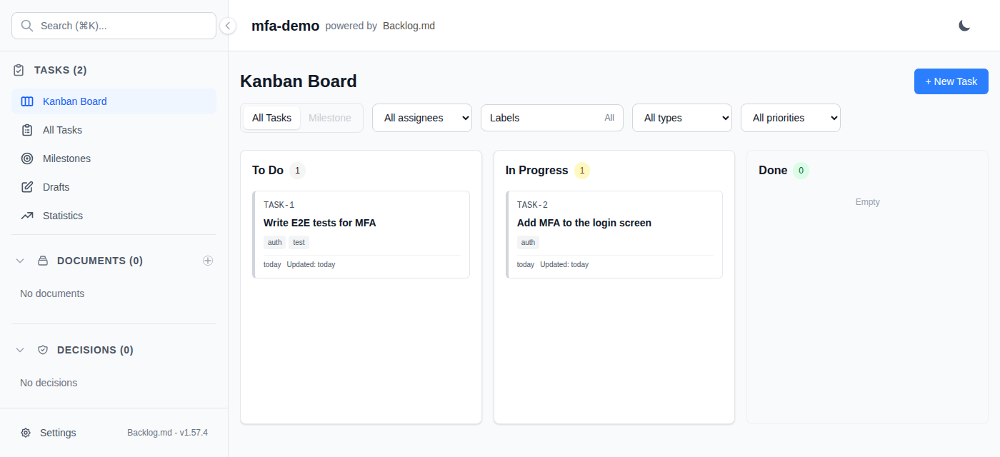
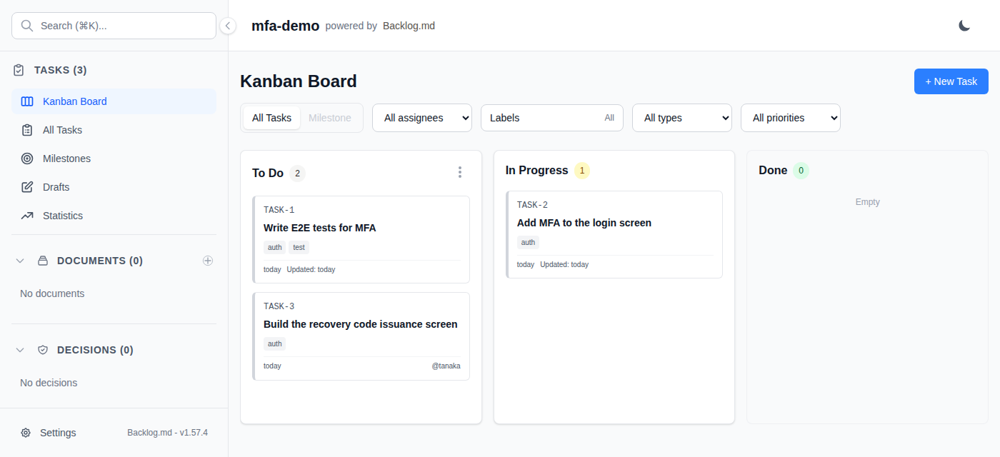
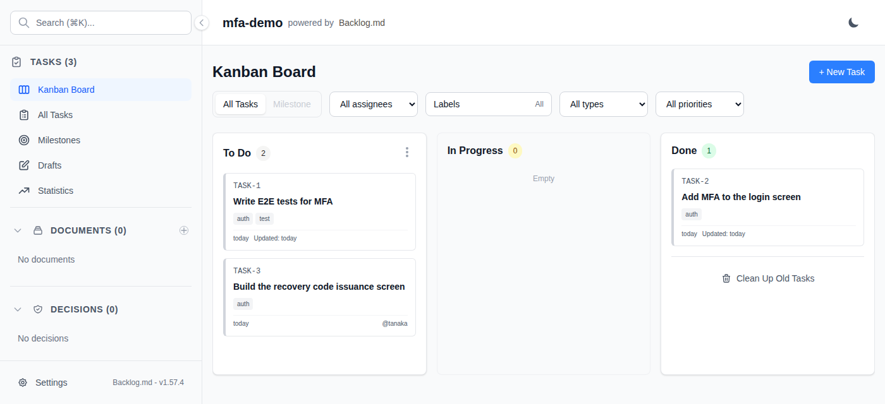

# Using Adaptrace with Backlog.md

[日本語](backlog-md.md) | English

> The Japanese version is the original. This translation follows it (ADR-003).

Developers handle day-to-day task management on the [Backlog.md](https://github.com/MrLesk/Backlog.md) kanban board, and the links to requirements and decisions are managed in Adaptrace. This guide explains how to split the work this way, step by step from installation.

- This guide covers the development version after Adaptrace v0.7, and Backlog.md v1.57.4. Review records use `verified`, which v0.7 does not handle. The exact conversion rules are in [the schema specification](../spec/schema.en.md#conversion-with-backlogmd-adaptrace-sync-bundle)
- The package is not published yet. In this guide, read `adaptrace` as `bun src/cli.ts` run in your clone of the repository
- The example project is the same MFA rollout as in [Using Adaptrace for project management](project-management.en.md)

## How the work is split

| Who | Uses | Does |
| --- | --- | --- |
| Developers | Backlog.md | Create, start and finish tasks. Day-to-day work on the kanban board |
| PM | Adaptrace | Manage requirements, decisions and risks. Impact analysis of change requests. `sync`, `stale` and `board` before regular meetings |

Both tools read and write Markdown files in the same repository.
`adaptrace sync` converts both ways between Adaptrace documents with `type: Task` and Backlog.md task files.
Only dependencies between tasks are passed to Backlog.md. The links to requirements and decisions stay in Adaptrace, so the kanban board stays uncluttered.

## 1. Install Backlog.md

Install it in one of these ways.

```bash
npm i -g backlog.md        # if you have Node.js
bun add -g backlog.md      # if you use Bun
brew install backlog-md    # if you use Homebrew
```

After installing, check the version.

```bash
backlog --version
```

```text
1.57.4
```

The `backlog` command installed with npm or Bun starts with Node.js.
If you do not have Node.js and see `env: 'node': No such file or directory`, you can run it directly with Bun.

```bash
bun x --bun backlog.md --version
```

In that case, read `backlog` in the rest of this guide as `bun x --bun backlog.md`.

## 2. Initialize both in the same repository

Initialize Adaptrace and Backlog.md at the root of the same repository.

```bash
cd my-project
backlog init "mfa-demo"
adaptrace init
```

`backlog init` asks for settings interactively. When you use it with Adaptrace, keep these two settings at their defaults.

| Setting | Value to choose | Reason |
| --- | --- | --- |
| Backlog directory | `backlog` | By default, `adaptrace sync` reads the `backlog` folder |
| Config location | folder (`backlog/config.yml`) | Adaptrace reads the list of statuses and the ID prefix from `backlog/config.yml` |

The other settings are up to you. If the defaults are fine for everything, `backlog init "mfa-demo" --defaults` skips the questions.
If you named the Backlog.md folder something else, such as `.backlog`, add `--backlog .backlog` to Adaptrace commands.

After initialization, the layout looks like this.

```text
my-project/
├── .adaptrace/          # Adaptrace bundle (requirements, decisions, tasks, risks and more)
│   ├── requirements/
│   ├── decisions/
│   ├── tasks/
│   └── ...
└── backlog/             # Backlog.md folder
    ├── config.yml
    └── tasks/
```

## 3. Match `state` values to Backlog.md statuses

Adaptrace's `state` corresponds to Backlog.md's `status`.
Adaptrace's `state` is the Backlog.md status in lowercase, with spaces replaced by `_`.

| Backlog.md `status` | Adaptrace `state` |
| --- | --- |
| `To Do` | `to_do` |
| `In Progress` | `in_progress` |
| `Done` | `done` |

The list of statuses is set by `statuses` in `backlog/config.yml`.
If you add a status, match Adaptrace's `state` to it.
Tasks with a `state` not in the list are not exported, and are shown as problems.

## 4. Export Adaptrace tasks to Backlog.md

Suppose Adaptrace already has the following two tasks.

```markdown
---
type: Task
title: Write E2E tests for MFA
state: to_do
owner: suzuki
tags: [auth, test]
generated: { by: human:tanaka, at: 2026-10-10T10:00:00+09:00 }
satisfies: /requirements/mfa.md
depends_on: /tasks/mfa-login.md
---

# Write E2E tests for MFA
```

The other is `tasks/mfa-login.md` (Add MFA to the login screen, `state: in_progress`).

First, run it without `--write` to see what would happen. At this stage, no file is changed.

```bash
adaptrace sync
```

```text
create in Backlog.md   tasks/mfa-e2e.md <-> tasks/task-1 - Write-E2E-tests-for-MFA.md (TASK-1)
create in Backlog.md   tasks/mfa-login.md <-> tasks/task-2 - Add-MFA-to-the-login-screen.md (TASK-2)
2 changes, 0 problems, 0 pending, 0 in sync. Run again with --write to apply
```

If it looks right, add `--write` to write the files.

```bash
adaptrace sync --write
```

Backlog.md now has files like this.

```markdown
---
id: TASK-1
title: Write E2E tests for MFA
status: To Do
created_date: '2026-11-25T04:58:44Z'
labels:
  - auth
  - test
dependencies:
  - TASK-2
updated_date: '2026-11-25T04:58:44Z'
---

# Write E2E tests for MFA
```

- `state` becomes `status`, and `tags` becomes `labels`
- Of the `depends_on` entries, only those pointing to tasks (`/tasks/mfa-login.md`) become `dependencies`. `satisfies`, which points to a requirement, is not passed
- `owner` and `due` are not passed either. They are treated as separate from the Backlog.md owner field (`assignee`)

A `backlog` field is added to the Adaptrace document to link the two.

```yaml
backlog:
  id: TASK-1
  sync: bbfe419a2004e735
  fields:
    created_date: 2026-11-25T04:58:44Z
```

`backlog.id` is the ID of the matching Backlog.md task. `backlog.sync` is a hash of the content at the last sync. Do not edit it by hand.

Open the Backlog.md web view, and the exported tasks are on the kanban board.

```bash
backlog browser
```



## 5. Developers move tasks in Backlog.md

Developers use Backlog.md as usual. They can use the web view (`backlog browser`), the terminal kanban board (`backlog board`), or commands.

For example, suppose a developer adds a task for the recovery code screen. It starts after the login screen task (TASK-2) is done, so they add a dependency.

```bash
backlog task create "Build the recovery code issuance screen" -a @tanaka -l auth --dep task-2
```



## 6. Bring the changes into Adaptrace

The PM runs `sync`, for example before a regular meeting, to bring in the changes from Backlog.md.

```bash
adaptrace sync
```

```text
create in Adaptrace    tasks/task-3.md <-> tasks/task-3 - Build-the-recovery-code-issuance-screen.md (TASK-3)
1 change, 0 problems, 0 pending, 2 in sync. Run again with --write to apply
```

```bash
adaptrace sync --write
```

Adaptrace now has `tasks/task-3.md`.

```markdown
---
type: Task
title: Build the recovery code issuance screen
state: to_do
tags:
  - auth
depends_on:
  - /tasks/mfa-login.md
backlog:
  id: TASK-3
  sync: 0bb33d295021df05
  fields:
    assignee:
      - "@tanaka"
    created_date: 2026-11-25T04:58:45Z
generated:
  by: adaptrace/0.7.0
  at: 2026-11-25T04:58:47Z
---
```

- Backlog.md's `dependencies` becomes Adaptrace's `depends_on`
- Fields with no matching Adaptrace field, such as the owner (`assignee`), go into `backlog.fields`. The next export returns them to Backlog.md unchanged
- **The PM adds the links to requirements.** Tasks created in Backlog.md have no `satisfies`. Adding something like `satisfies: /requirements/mfa.md` makes the task a target of `impact` and `estimate`. Adding it does not change anything in Backlog.md at the next `sync`

After bringing in the changes, check the whole picture with `board`.

```bash
adaptrace board
```

```text
To Do (2)
  - Write E2E tests for MFA  tasks/mfa-e2e.md  waiting for tasks/mfa-login.md
  - Build the recovery code issuance screen  tasks/task-3.md  waiting for tasks/mfa-login.md

In Progress (1)
  - Add MFA to the login screen  tasks/mfa-login.md
```

"waiting for" shows that the task is waiting for a task that is not finished.
The columns are in the order of `statuses` in `backlog/config.yml`.

### When a task is finished

Suppose a developer moves TASK-2 to `Done`.



When you run `sync`, Adaptrace's `state` becomes `done`.

```text
update Adaptrace       tasks/mfa-login.md <-> tasks/task-2 - Add-MFA-to-the-login-screen.md (TASK-2)  [state, fields]
1 change, 0 problems, 0 pending, 2 in sync. Written
```

"waiting for" also disappears from `board`.

```text
To Do (2)
  - Write E2E tests for MFA  tasks/mfa-e2e.md
  - Build the recovery code issuance screen  tasks/task-3.md

Done (1)
  - Add MFA to the login screen  tasks/mfa-login.md
```

## 7. When the same task changes on both sides

If the same task changes in both Adaptrace and Backlog.md after the last `sync`, `sync` does not overwrite anything. It reports a conflict instead.

```text
CONFLICT (changed on both sides) tasks/mfa-e2e.md <-> tasks/task-1 - Write-E2E-tests-for-MFA.md (TASK-1)  [title, state, fields]
0 changes, 1 problem, 0 pending, 2 in sync
```

In this case, the exit code is 1. Decide which side's content to keep, then run with `--resolve`.

```bash
adaptrace sync --resolve backlog --write     # keep the Backlog.md content
adaptrace sync --resolve adaptrace --write   # keep the Adaptrace content
```

You can also decide the side task by task. Name the task by its bundle path or its Backlog.md id.

```bash
adaptrace sync --resolve tasks/design.md=adaptrace --resolve back-7=backlog --write
```

Even with `--resolve`, nothing is written unless you add `--write`.
Changes on the side you did not choose are lost. If you need them, restore them by hand afterwards.

If you use Claude Code, the skill `adaptrace-sync` shows both sides of each conflict side by side and decides with you which side to keep. To keep the changes of both, it writes them into the Adaptrace document and then keeps the Adaptrace side. This skill is available from the release after v1.0.0. You get the skill the same way as in [the guide to adopting Adaptrace in an existing repository](adoption.en.md#have-claude-code-help-you-bring-in-files). If you installed the plugin, you already have all the skills. If you copy the folder, replace `adaptrace-adopt` in the command with `adaptrace-sync`.

To sync in one direction only, add `--direction import` (bring in only) or `--direction export` (export only).

## Steps before a regular meeting

Before a regular meeting, the PM runs these in order.

```bash
git pull
adaptrace sync                 # check what will change
adaptrace sync --write         # bring in the changes
adaptrace stale                # check documents older than what they depend on
adaptrace board --format markdown
```

You can paste the output of `board --format markdown` directly into minutes or an issue.

```markdown
## To Do (2)

- Write E2E tests for MFA (`tasks/mfa-e2e.md`)
- Build the recovery code issuance screen (`tasks/task-3.md`)

## Done (1)

- Add MFA to the login screen (`tasks/mfa-login.md`)
```

Commit the files that `sync` changed, in both `.adaptrace/` and `backlog/`.

## Common pitfalls

- **One designated person runs `sync --write`.** If several people export on separate branches, new tasks can get the same ID. Have one person, such as the PM, run it
- **Bringing in a task updates `generated`.** For a task brought in from Backlog.md, `generated.by` becomes a value like `adaptrace/0.7.0`, and `generated.at` becomes the time it was brought in. As a result, later tasks that have `depends_on` pointing to that task are shown by `stale` as "older than what they depend on". If those later tasks do not need review, add `verified: { by, at }` with the current date and time to them, and they are no longer shown
- **Deletions are not passed on.** If you delete a task file in Backlog.md, `sync` reports `MISSING in Backlog.md`. It does not delete the Adaptrace document. When it is no longer needed, delete the Adaptrace document by hand too, or set `status: deprecated`
- **Drafts and archives are not converted.** Tasks in `backlog/tasks/` and `backlog/completed/` are converted. Tasks in `backlog/drafts/` and `backlog/archive/` are not. However, their IDs are not reused for new tasks
- **Archived tasks are shown as `ARCHIVED in Backlog.md`.** The Adaptrace document is not changed. It is not a problem, so the exit code stays 0. You can keep the Adaptrace document as a record
- **Use only letters, digits, `.`, `_` and `-` in the ID prefix.** If `task_prefix` in `backlog/config.yml` does not meet this rule, new tasks are not exported
- **Do not write progress in `status`.** Adaptrace's `status` is used only for the lifecycle (`draft`, `stable`, `deprecated`). What corresponds to Backlog.md's `status` is Adaptrace's `state`
