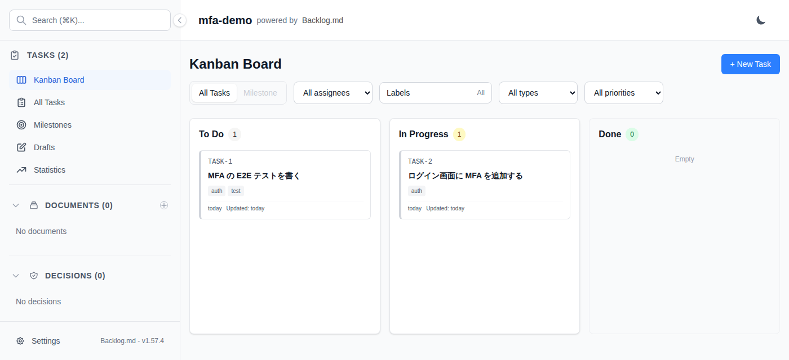
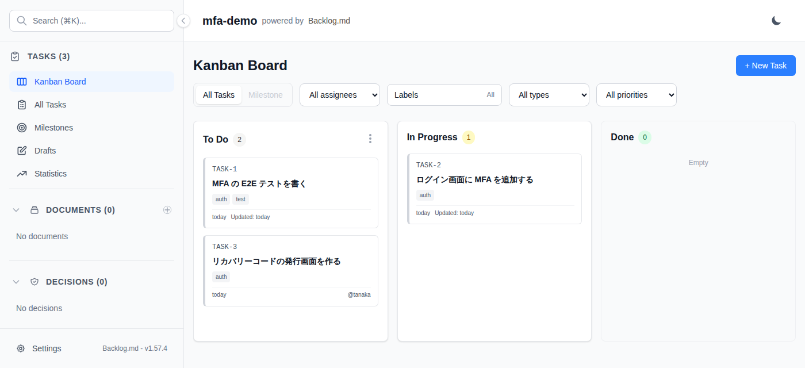
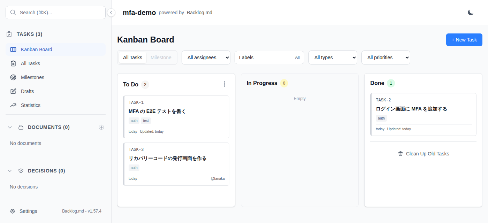

# Backlog.mdと併用する

日本語 | [English](backlog-md.en.md)

日々のタスク管理は [Backlog.md](https://github.com/MrLesk/Backlog.md) のカンバンで行い、要件や判断とのつながりはAdaptraceで管理する。このような分担のやり方を、インストールから順に説明します。

- 対象は、Adaptrace v0.7の後の開発版と、Backlog.md v1.57.4です。見直しの記録に、v0.7にない `verified` の扱いを使います。変換の正確な決まりは、[スキーマの仕様](../spec/schema.md#backlogmdとの変換adaptrace-sync-bundle) にあります
- パッケージは未公開です。この文書の `adaptrace` は、cloneしたリポジトリでの `bun src/cli.ts` と読み替えてください
- 例のプロジェクトは、[プロジェクトマネジメントでの使い方](project-management.md) と同じMFAの導入です

## 分担の考え方

| 誰が | 使うもの | やること |
| --- | --- | --- |
| 開発者 | Backlog.md | タスクの作成、着手、完了。カンバンでの日々の操作 |
| PM | Adaptrace | 要件・判断・リスクの管理。変更要求の影響分析。定例の前の `sync`、`stale`、`board` |

2つのツールは、どちらも同じリポジトリの中のMarkdownファイルを読み書きします。
`adaptrace sync` が、Adaptraceの `type: Task` の文書と、Backlog.mdのタスクのファイルを双方向に変換します。
Backlog.mdには、タスクとタスクの間の依存だけが渡ります。要件や判断とのつながりはAdaptraceに残るので、カンバンが散らかりません。

## 1. Backlog.mdをインストールする

次のどれか1つでインストールします。

```bash
npm i -g backlog.md        # Node.js がある場合
bun add -g backlog.md      # Bun を使う場合
brew install backlog-md    # Homebrew を使う場合
```

インストールできたら、バージョンを確認します。

```bash
backlog --version
```

```text
1.57.4
```

npmやBunでインストールした `backlog` コマンドは、Node.jsで起動します。
Node.jsがなく、`env: 'node': No such file or directory` と表示される場合は、Bunから直接実行できます。

```bash
bun x --bun backlog.md --version
```

この場合は、以降の `backlog` を `bun x --bun backlog.md` と読み替えてください。

## 2. 同じリポジトリで初期化する

AdaptraceとBacklog.mdは、同じリポジトリのルートで初期化します。

```bash
cd my-project
backlog init "mfa-demo"
adaptrace init
```

`backlog init` は、対話形式で設定を聞いてきます。Adaptraceと併用するときは、次の2つを既定のままにしてください。

| 設定 | 選ぶ値 | 理由 |
| --- | --- | --- |
| Backlog directory | `backlog` | `adaptrace sync` は、既定で `backlog` フォルダを読みます |
| Config location | folder（`backlog/config.yml`） | Adaptraceは `backlog/config.yml` から、ステータスの一覧とIDの接頭辞を読みます |

ほかの設定は自由です。すべて既定でよければ、`backlog init "mfa-demo" --defaults` で対話を省けます。
Backlog.mdのフォルダを `.backlog` などにした場合は、Adaptraceのコマンドに `--backlog .backlog` を付けます。

初期化すると、次の構成になります。

```text
my-project/
├── .adaptrace/          # Adaptrace のバンドル（要件、判断、タスク、リスクなど）
│   ├── requirements/
│   ├── decisions/
│   ├── tasks/
│   └── ...
└── backlog/             # Backlog.md のフォルダ
    ├── config.yml
    └── tasks/
```

## 3. `state` の値をBacklog.mdのステータスにそろえる

Adaptraceの `state` と、Backlog.mdの `status` が対応します。
Backlog.mdのステータスを小文字にし、空白を `_` にした値が、Adaptraceの `state` です。

| Backlog.mdの `status` | Adaptraceの `state` |
| --- | --- |
| `To Do` | `to_do` |
| `In Progress` | `in_progress` |
| `Done` | `done` |

ステータスの一覧は、`backlog/config.yml` の `statuses` で決まります。
ステータスを追加した場合は、Adaptraceの `state` もそれに合わせます。
一覧にない `state` のタスクは書き出さず、問題として表示します。

## 4. AdaptraceのタスクをBacklog.mdに書き出す

Adaptraceには、すでに次の2つのタスクがあるとします。

```markdown
---
type: Task
title: MFA の E2E テストを書く
state: to_do
owner: suzuki
tags: [auth, test]
generated: { by: human:tanaka, at: 2026-10-10T10:00:00+09:00 }
satisfies: /requirements/mfa.md
depends_on: /tasks/mfa-login.md
---

# MFA の E2E テストを書く
```

もう1つは `tasks/mfa-login.md`（ログイン画面にMFAを追加する、`state: in_progress`）です。

まず、`--write` を付けずに実行して、何が起きるかを確認します。この段階では、どのファイルも変更しません。

```bash
adaptrace sync
```

```text
create in Backlog.md   tasks/mfa-e2e.md <-> tasks/task-1 - MFA-の-E2E-テストを書く.md (TASK-1)
create in Backlog.md   tasks/mfa-login.md <-> tasks/task-2 - ログイン画面に-MFA-を追加する.md (TASK-2)
2 changes, 0 problems, 0 pending, 0 in sync. Run again with --write to apply
```

内容がよければ、`--write` を付けて書き込みます。

```bash
adaptrace sync --write
```

Backlog.mdには、次のようなファイルができます。

```markdown
---
id: TASK-1
title: MFA の E2E テストを書く
status: To Do
created_date: '2026-11-25T04:58:44Z'
labels:
  - auth
  - test
dependencies:
  - TASK-2
updated_date: '2026-11-25T04:58:44Z'
---

# MFA の E2E テストを書く
```

- `state` は `status` に、`tags` は `labels` になります
- `depends_on` のうち、タスクへのもの（`/tasks/mfa-login.md`）だけが `dependencies` になります。要件への `satisfies` は渡りません
- `owner` や `due` も渡りません。Backlog.mdの担当者（`assignee`）とは別の項目として扱います

Adaptrace側の文書には、対応づけのための `backlog` が追加されます。

```yaml
backlog:
  id: TASK-1
  sync: bbfe419a2004e735
  fields:
    created_date: 2026-11-25T04:58:44Z
```

`backlog.id` は、対応するBacklog.mdのタスクのIDです。`backlog.sync` は、前回そろえたときの内容のハッシュです。手で書き換えないでください。

Backlog.mdのWeb画面を開くと、書き出したタスクがカンバンに並んでいます。

```bash
backlog browser
```



## 5. 開発者はBacklog.mdでタスクを動かす

開発者は、いつもどおりBacklog.mdを使います。Web画面（`backlog browser`）でも、ターミナルのカンバン（`backlog board`）でも、コマンドでも構いません。

たとえば、開発者がリカバリーコードの画面のタスクを追加したとします。ログイン画面のタスク（TASK-2）が終わってから着手するので、依存を付けます。

```bash
backlog task create "リカバリーコードの発行画面を作る" -a @tanaka -l auth --dep task-2
```



## 6. 変更をAdaptraceに取り込む

PMは、定例の前などに `sync` を実行して、Backlog.mdの変更を取り込みます。

```bash
adaptrace sync
```

```text
create in Adaptrace    tasks/task-3.md <-> tasks/task-3 - リカバリーコードの発行画面を作る.md (TASK-3)
1 change, 0 problems, 0 pending, 2 in sync. Run again with --write to apply
```

```bash
adaptrace sync --write
```

Adaptraceには `tasks/task-3.md` ができます。

```markdown
---
type: Task
title: リカバリーコードの発行画面を作る
state: to_do
tags:
  - auth
depends_on:
  - /tasks/mfa-login.md
backlog:
  id: TASK-3
  sync: 0bb33d295021df05
  fields:
    assignee:
      - "@tanaka"
    created_date: 2026-11-25T04:58:45Z
generated:
  by: adaptrace/0.7.0
  at: 2026-11-25T04:58:47Z
---
```

- Backlog.mdの `dependencies` は、Adaptraceの `depends_on` になります
- 担当者（`assignee`）など、対応する項目がないものは `backlog.fields` に入ります。次に書き出すときに、そのままBacklog.mdに戻ります
- **要件とのつながりは、PMが追加します。** Backlog.mdで作ったタスクには、`satisfies` がありません。`satisfies: /requirements/mfa.md` などを追加すると、`impact` や `estimate` の対象になります。追加しても、次の `sync` でBacklog.mdに変更は起きません

取り込んだら、`board` で全体を確認します。

```bash
adaptrace board
```

```text
To Do (2)
  - MFA の E2E テストを書く  tasks/mfa-e2e.md  waiting for tasks/mfa-login.md
  - リカバリーコードの発行画面を作る  tasks/task-3.md  waiting for tasks/mfa-login.md

In Progress (1)
  - ログイン画面に MFA を追加する  tasks/mfa-login.md
```

「waiting for」は、終わっていないタスクを待っていることを示します。
列の順は、`backlog/config.yml` の `statuses` の順です。

### タスクが終わったとき

開発者がTASK-2を `Done` に移したとします。



`sync` を実行すると、Adaptraceの `state` が `done` になります。

```text
update Adaptrace       tasks/mfa-login.md <-> tasks/task-2 - ログイン画面に-MFA-を追加する.md (TASK-2)  [state, fields]
1 change, 0 problems, 0 pending, 2 in sync. Written
```

`board` からも「waiting for」が消えます。

```text
To Do (2)
  - MFA の E2E テストを書く  tasks/mfa-e2e.md
  - リカバリーコードの発行画面を作る  tasks/task-3.md

Done (1)
  - ログイン画面に MFA を追加する  tasks/mfa-login.md
```

## 7. 両側で同じタスクが変わったとき

前回の `sync` の後に、同じタスクがAdaptraceとBacklog.mdの両方で変わると、`sync` は上書きせずに衝突として知らせます。

```text
CONFLICT (changed on both sides) tasks/mfa-e2e.md <-> tasks/task-1 - MFA-の-E2E-テストを書く.md (TASK-1)  [title, state, fields]
0 changes, 1 problem, 0 pending, 2 in sync
```

この場合、終了コードは1です。どちらの内容にそろえるかを決めて、`--resolve` を付けて実行します。

```bash
adaptrace sync --resolve backlog --write     # Backlog.md の内容にそろえる
adaptrace sync --resolve adaptrace --write   # Adaptrace の内容にそろえる
```

タスクごとに、どちらにそろえるかを決めることもできます。タスクは、バンドルの中のパスか、Backlog.mdのIDで指定します。

```bash
adaptrace sync --resolve tasks/design.md=adaptrace --resolve back-7=backlog --write
```

`--resolve` でも、`--write` を付けなければ確認だけです。
選ばなかった側の変更は失われます。必要な変更は、そろえた後で手で戻してください。

Claude Codeを使っている場合は、skill `adaptrace-sync` が、衝突ごとに両側の内容を並べて示し、どちらにそろえるかを一緒に決めます。両方の変更を残すときは、Adaptraceの文書に書いてから、Adaptraceの側にそろえます。このskillは、v1.0.0の次のリリースから使えます。skillの入手方法は、[既存のリポジトリに導入するガイド](adoption.md#claude-codeに取り込みを手伝ってもらう) と同じです。プラグインでインストールした場合は、すべてのskillがそろっています。フォルダをコピーする場合は、コマンドの `adaptrace-adopt` を `adaptrace-sync` に置き換えてください。

片方向だけにしたいときは、`--direction import`（取り込むだけ）か `--direction export`（書き出すだけ）を付けます。

## 定例の前の流れ

PMは、定例の前に次の順で実行します。

```bash
git pull
adaptrace sync                 # 何が変わるかを確認する
adaptrace sync --write         # 取り込む
adaptrace stale                # 依存先より古い文書を確認する
adaptrace board --format markdown
```

`board --format markdown` の出力は、そのまま議事録やIssueに貼れます。

```markdown
## To Do (2)

- MFA の E2E テストを書く (`tasks/mfa-e2e.md`)
- リカバリーコードの発行画面を作る (`tasks/task-3.md`)

## Done (1)

- ログイン画面に MFA を追加する (`tasks/mfa-login.md`)
```

`sync` で変わったファイルは、`.adaptrace/` と `backlog/` の両方をコミットします。

## つまずきやすい点

- **`sync --write` は、決まった人が実行します。** 複数の人が別々のブランチで書き出すと、新しいタスクに同じIDが振られることがあります。PMなど、1人が実行してください
- **取り込むと、`generated` が更新されます。** Backlog.mdから取り込んだタスクは、`generated.by` が `adaptrace/0.7.0` のような値に、`generated.at` が取り込んだ日時になります。そのため、そのタスクに `depends_on` している後続のタスクが、`stale` に「依存先より古い」と表示されます。後続のタスクを見直す必要がなければ、その文書に `verified: { by, at }` を今の日時で追加すると、表示が消えます
- **削除は伝わりません。** Backlog.mdでタスクのファイルを削除すると、`sync` は `MISSING in Backlog.md` と知らせます。Adaptrace側の文書は削除しません。不要になったら、Adaptraceの文書も手で削除するか、`status: deprecated` にします
- **下書きとアーカイブは変換しません。** 対象は `backlog/tasks/` と `backlog/completed/` のタスクです。`backlog/drafts/` と `backlog/archive/` のタスクは変換しません。ただし、そのIDは新しいタスクに使いません
- **アーカイブしたタスクは、`ARCHIVED in Backlog.md` と表示されます。** Adaptrace側の文書は変えません。問題ではないので、終了コードは0のままです。Adaptraceの文書は、経緯としてそのまま残せます
- **IDの接頭辞は、英字・数字・`.`・`_`・`-` だけにします。** `backlog/config.yml` の `task_prefix` がこの条件に合わないと、新しいタスクを書き出しません
- **`status` に進み具合を書かないでください。** Adaptraceの `status` は、ライフサイクル（`draft`、`stable`、`deprecated`）だけに使います。Backlog.mdの `status` に当たるのは、Adaptraceの `state` です
