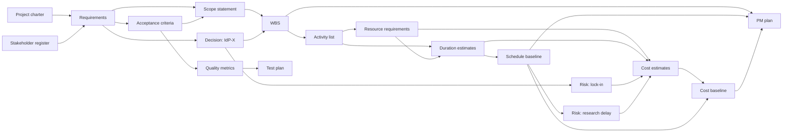

# Updating PMBOK documents for a change request

[日本語](pmbok.md) | English

> The Japanese version is the original. This translation follows it (ADR-003).

In a project that follows PMBOK, an approved change request means you must update the scope statement, the WBS, the schedule, the costs, the risk register and more.
If you track by hand which documents need an update, it is easy to miss some.
This guide shows how to manage PMBOK documents with Adaptrace, and how to list every document to review for each change request without missing any.

- This guide covers the development version after Adaptrace v0.7. It uses features that v0.7 does not have: `impact --order review`, `progress`, `list`, `conflicts`, `meeting`, `changes`, and detecting file updates with `resource`. The exact rules for keys and commands are in [the schema specification](../spec/schema.en.md)
- The package is not published yet. In this guide, read `adaptrace` as `bun src/cli.ts` in a cloned repository
- The document names follow the "PMBOK Guide, Sixth Edition", which lists the inputs and outputs of each process
- The example is the same MFA rollout project as in [Using Adaptrace for project management](project-management.en.md). It covers the moment when the customer sends a change request: "We also want to receive the code by SMS"

## Overview

1. Put each PMBOK document in the bundle as its own Markdown document
2. Write the dependencies between documents in the frontmatter, in the direction from upstream to downstream
3. When a change request arrives, use `estimate` to list the affected documents. Use the list as input for the Change Control Board (CCB)
4. Once the request is approved, update the documents upstream first, in the order that `impact --order review` shows. For documents that needed no change, record the review in `verified`
5. Use `progress` to check that no document is left unreviewed

## 1. Put the documents in the bundle

A template based on the examples in this section is in [examples/pmbok/](../../examples/pmbok/README.md). It does not include work items (`tasks/`).
In the template, the risks are reduced to one sample entry, and dependencies on the subsidiary plans and the assumptions are added.
The diagram in this section and the "Review order" list later leave out the subsidiary plans and the assumptions. You can check the exact order for the template with `impact --order review`.
There is a minimal set (12 documents) and a standard set (28 documents). Copy one and you can start right away.

### One document per file

Adaptrace treats each Markdown file in the bundle as one document. Dependencies are also set per file.
So, as a rule, put each PMBOK document in its own file.

Split the project management plan: put the subsidiary plans and the baselines in separate files.
If you keep it in one file, a change to any one section puts every document that depends on the plan up for review.

Here is an example folder layout.

```text
.adaptrace/
├── initiating/
│   ├── business-case.md              # Business case
│   ├── project-charter.md            # Project charter
│   └── stakeholder-register.md       # Stakeholder register
├── assumptions/                      # Assumption log (one file per entry)
├── plans/
│   ├── project-management-plan.md    # Project management plan (overall)
│   ├── scope-management-plan.md      # Scope management plan
│   ├── schedule-management-plan.md   # Schedule management plan
│   ├── cost-management-plan.md       # Cost management plan
│   └── ...                           # Quality, resources, communications, risk and more
├── requirements/                     # Requirements documentation (one file per entry)
├── acceptance/                       # Acceptance criteria
├── decisions/                        # Decisions
├── scope/
│   ├── scope-statement.md            # Project scope statement
│   └── wbs.md                        # WBS and WBS dictionary
├── schedule/
│   ├── activity-list.md              # Activity list
│   ├── duration-estimates.md         # Duration estimates
│   └── schedule-baseline.md          # Schedule baseline
├── resources/resource-requirements.md # Resource requirements
├── cost/
│   ├── cost-estimates.md             # Cost estimates
│   └── cost-baseline.md              # Cost baseline
├── quality/
│   ├── quality-metrics.md            # Quality metrics
│   └── test-plan.md                  # Test and evaluation documents
├── risks/                            # Risk register (one file per entry)
├── milestones/                       # Milestone list (one file per entry)
├── change-requests/                  # Change requests (also serve as the change log)
└── tasks/                            # Work items (can be converted to and from Backlog.md)
```

### Choose the types

For `type`, use the types Adaptrace provides for the documents they fit.
For a document that no provided type fits, use its English PMBOK name as `type`. A type that is not in the table does not cause an error.

| PMBOK document | `type` |
| --- | --- |
| Requirements documentation | `Requirement` (one file per entry) |
| Acceptance criteria in the scope statement | `Acceptance` |
| Risk register | `Risk` (one file per entry) |
| Milestone list | `Milestone` (one file per entry) |
| Change requests, change log | `Change Request` (one file per entry) |
| Meeting minutes | `Meeting` |
| Decision records | `Decision` |
| WBS work packages, activities | `Task` (only when needed) |
| Project charter | `Project Charter` |
| Subsidiary plans | `Management Plan` |
| Scope statement | `Scope Statement` |
| WBS and WBS dictionary | `WBS` |
| Schedule baseline | `Schedule Baseline` |
| Cost estimates | `Cost Estimates` |
| Stakeholder register | `Stakeholder Register` |
| Business case | `Business Case` |
| Project management plan (overall) | `Project Management Plan` |
| Activity list | `Activity List` |
| Resource requirements | `Resource Requirements` |
| Duration estimates | `Duration Estimates` |
| Cost baseline | `Cost Baseline` |
| Quality metrics | `Quality Metrics` |
| Test and evaluation documents | `Test and Evaluation Documents` |

Keep type names consistent within a project. If the same kind of document uses both `Cost Estimate` and `Cost Estimates`, `estimate` counts them separately.

### One file per entry for registers and logs

Documents that list entries, such as the risk register, the requirements documentation and the change log, get one file per entry.
With one file per entry, when only the "lock-in risk" changes, only the documents related to that risk come up for review.
If the register is a single file, every change to any entry puts every document that depends on the register up for review.

The issue log, the assumption log and the lessons learned register are also easier to handle with one file per entry, when each entry relates to different documents.
Name the type after the entry, such as `Issue`, `Assumption` or `Lesson`.

### Do not make a requirements traceability matrix

The links from requirements to acceptance criteria, the WBS and tests are exactly what Adaptrace's dependencies hold.
If you manage them as a separate table, the table drifts away from the dependencies.
If you need a table, output a diagram with `adaptrace graph`, or data with `adaptrace graph --format json`.
To make a table of what satisfies each requirement and how far that work is, use `adaptrace coverage --format markdown`. A requirement that nothing satisfies is shown as `uncovered`. With `--milestone`, it narrows to that milestone's scope and also shows the work the milestone waits for. `coverage` is available from v1.1.0.

### Put a stand-in document for Excel and MS Project files

Adaptrace reads only Markdown files. A WBS in Excel or a schedule in MS Project cannot be the target of a dependency.
For such files, put a Markdown "stand-in document" in the bundle, and point to the actual file with `resource`.

```markdown
---
type: Schedule Baseline
title: Schedule baseline
resource: ../../pm/schedule.mpp
generated: { by: human:sato, at: 2026-10-07T10:00:00+09:00 }
depends_on:
  - /schedule/duration-estimates.md
  - /milestones/release.md
---

# Schedule baseline

The actual file is [schedule.mpp](../../pm/schedule.mpp). The baseline version is v3 (approved 2026-10-07).
```

When you run `adaptrace stale`, it shows that no value is recorded, and shows the file's current SHA-256 (a value computed from its content).

```text
schedule/schedule-baseline.md  updated 2026-10-07T10:00:00+09:00 (generated.at)
  no sha256 recorded for its file ../../pm/schedule.mpp (now 3f2a…c91e)
```

Record the value shown in `resource_sha256`.

```yaml
resource: ../../pm/schedule.mpp
resource_sha256: 3f2a…c91e
```

From now on, when the actual file is updated, `stale` shows "its file … changed".
After you review the stand-in document, record the new value. If you changed its content, update `generated`. If you did not, update `verified`.
If the document is based on more than one file, list them in `sources` and record a `sha256` for each.

```yaml
sources:
  - resource: ../../pm/wbs.xlsx
    sha256: 9b0d…41aa
  - resource: ../../pm/resource-plan.xlsx
    sha256: c4e7…08f2
```

## 2. Set the dependencies

### Follow the flow from upstream to downstream

A dependency points to an "input used to make the document".
If one document is an input to another in a PMBOK process, set the dependency from the downstream document to the upstream document.

| Key | When to use it | Example |
| --- | --- | --- |
| `derived_from` | The document was made from the target | The scope statement is made from the requirements documentation |
| `depends_on` | The document assumes the target | The cost baseline assumes the schedule baseline |
| `satisfies` | The work item fulfills the target | A task fulfills a requirement |

The example project sets them as follows. An arrow means "if this changes, review the document the arrow points to".



In the frontmatter, write the dependency in the document the arrow points to. For the cost estimates, it looks like this.

```yaml
type: Cost Estimates
title: Cost estimates
depends_on:
  - /resources/resource-requirements.md
  - /schedule/duration-estimates.md
  - /risks/idp-lockin.md
  - /risks/schedule-delay.md
  - /plans/cost-management-plan.md
```

The project management plan has `depends_on` on the subsidiary plans and the three baselines.
Then, when any of them changes, a review of the whole plan also appears in the list.

### Avoid cycles

Some PMBOK documents affect each other.
For example, the schedule includes reserve time for risks, and risks are identified based on the schedule.
If you set `depends_on` in both directions, you get a cycle, and `validate` reports it as an error.

```text
error   risks/schedule-delay.md:6  cycle: risks/schedule-delay.md depends_on schedule/schedule-baseline.md, schedule/schedule-baseline.md depends_on risks/schedule-delay.md  [dependency-cycle]
```

To avoid the cycle, do one of the following.

- **Pick one direction, and use a body link for the other.** In this example, the risk depends on the schedule. The schedule refers to the risk in its body
- **Split the document.** Make "schedule reserve" a separate document that depends on the risk. Make the schedule baseline depend on the schedule reserve

If you are unsure, make upstream the document that the PMBOK planning processes create first.

### Do not connect everything

For documents that are only related, link them in the body. Put in the frontmatter only the documents you really must review when the target changes.
If you connect too much, a single change request puts almost every document up for review.

## 3. Take in a change request

Make one file per change request. The list of documents in `change-requests/` is your change log.
To turn the change log into a table, use `list`. The `--format markdown` output can be pasted as is into minutes or an Issue.
If you save the `--format csv` output to a file, you can open it in a spreadsheet such as Excel. Example: `adaptrace list --type "Change Request" --format csv > change-log.csv`

```bash
adaptrace list --type "Change Request" --columns state,requested_by,received_at --sort received_at --format markdown
```

```markdown
---
type: Change Request
title: Also receive the code by SMS
state: submitted
requested_by: Customer A Corp.
received_at: 2026-11-18T10:00:00+09:00
generated: { by: human:sato, at: 2026-11-18T10:00:00+09:00 }
---

# Also receive the code by SMS
```

In `received_at`, write the date and time the change request was received.
Later, `progress` uses it to decide whether the starting documents were updated for this change request.
You may update `generated.at` each time you change `state`, but do not change `received_at`. However, once a starting document points to this change request with `derived_from`, do not change `generated` either. Otherwise the starting document is judged out of date. If you create a change request by copying an old one, rewrite `received_at`.

The project decides the values of `state`. For example: `submitted`, `approved`, `rejected`, `deferred`, `implemented` and `closed`.

If you use Claude Code, you can use the skill `adaptrace-change-request`. A skill is a file that teaches Claude Code the steps of a task. Give this skill the request e-mail or text, and you can go through the steps in this section in a conversation. It creates the change request document, and shows the impact range and overlapping change requests. You get the skill the same way as in [the guide to adopting Adaptrace in an existing repository](adoption.en.md#have-claude-code-help-you-bring-in-files). If you installed the plugin, you already have all the skills. If you copy the folder, replace `adaptrace-adopt` in the command with `adaptrace-change-request`.

### Decide the starting documents

The documents a change request changes directly are called the "starting documents". In this example, the requirement (`requirements/mfa.md`) is the starting document.
If the SMS provider becomes a new stakeholder, the stakeholder register is also a starting document.

Write the starting documents in the change request's `changes`.

```yaml
changes:
  - /requirements/mfa.md
  - /initiating/stakeholder-register.md
```

You may write `changes` before approval. It does not pass on the chain of reviews, so no other document becomes out of date.
With it in place, you do not need to pass the starting documents to `estimate` (`adaptrace estimate --request change-requests/cr-002-sms.md`).

### Check for overlapping change requests

In a large project, you may receive change requests that contradict each other, from different people through different channels.
`conflicts` shows the pairs of open change requests whose impact ranges overlap.

```bash
adaptrace conflicts --format markdown
```

Pairs that change the same starting document, or that reach the same baseline, may contradict each other. Discuss them together before you approve either one.

With `--llm "claude -p"`, an LLM judges for each pair whether the two can coexist (`conflict`, `duplicate`, `compatible`, `unclear`), and what the discussion needs to decide.
The LLM's judgment is input for the discussion. It is not a decision.

### Prepare the discussion meeting

For overlapping change requests, first decide the direction inside your company, then consult the customer. With `meeting`, you can create the material to prepare each meeting.

In the next example, `cr-002-sms.md` overlaps with another change request, `cr-003-email.md`, which asks to deprecate the e-mail code.

```bash
adaptrace meeting change-requests/cr-002-sms.md change-requests/cr-003-email.md
adaptrace meeting change-requests/cr-002-sms.md change-requests/cr-003-email.md --audience customer
```

- The candidate participants are the owners of the affected documents (`owner`) and the people who submitted the change requests (`requested_by`)
- Whether a person is internal or customer is decided only by `side` in the stakeholder's document. In `owner` and `requested_by`, write the path of that document, starting with `/` (`requested_by: /stakeholders/a-corp.md`)
- If you write only a name, such as `requested_by: Customer A Corp.` in the example in the previous section, `meeting` treats the person as unknown: neither internal nor customer. Create a stakeholder document and write its path
- The candidates for an internal meeting are only people known to be internal through a document with `side: internal`. People who could be either, such as an `owner` given only by name, are marked as "needs checking before inviting". This is to avoid inviting a customer to an internal meeting by mistake

```yaml
# stakeholders/a-corp.md
type: Stakeholder
title: Customer A Corp. IT Department
side: customer
role: Client's point of contact
```

- The material for a meeting with the customer does not include the details of the internal discussion (affected documents, overlaps, baselines, and the names of the documents each person owns)
- With `--llm "claude -p"`, it also creates the points the discussion needs to decide, and a draft invitation
- With `--write`, it creates a `Meeting` draft in `meetings/`. After the meeting, give the minutes to `extract` to draft a `Decision` for the direction
- Adaptrace does not schedule meetings or send invitations. It does not store contact details in the bundle either

### List the affected documents

Give `estimate` the starting documents and the change request, and it lists the affected documents. You can give more than one starting document.

```bash
adaptrace estimate requirements/mfa.md --request change-requests/cr-002-sms.md --format markdown
```

```text
# Change estimate: `change-requests/cr-002-sms.md`

Starts from `requirements/mfa.md` and reaches 16 more documents. 17 documents in all: Requirement 1, Acceptance 1, Decision 1, Scope Statement 1, Task 1, Quality Metrics 1, Risk 2, WBS 1, Cost Estimates 1, Project Management Plan 1, Test and Evaluation Documents 1, Activity List 1, Cost Baseline 1, Resource Requirements 1, Duration Estimates 1, Schedule Baseline 1.

## Documents

| Document | Type | State | Owner | Due | Via |
| --- | --- | --- | --- | --- | --- |
| Add MFA to login (`requirements/mfa.md`) | Requirement |  |  |  | (changed) |
| MFA acceptance criteria (`acceptance/mfa.md`) | Acceptance |  |  |  | derived_from -> requirements/mfa.md |
| Use IdP-X for authentication (`decisions/auth-provider.md`) | Decision |  |  |  | depends_on -> requirements/mfa.md |
| Project scope statement (`scope/scope-statement.md`) | Scope Statement |  |  |  | derived_from -> requirements/mfa.md |
...
| Cost baseline (`cost/cost-baseline.md`) | Cost Baseline |  |  |  | depends_on -> cost/cost-estimates.md |
| Schedule baseline (`schedule/schedule-baseline.md`) | Schedule Baseline |  |  |  | depends_on -> schedule/duration-estimates.md |
| SDK research delay (`risks/schedule-delay.md`) | Risk |  |  |  | depends_on -> schedule/schedule-baseline.md |
```

- You can see which of the three baselines are affected. A change to a baseline is input that needs CCB approval
- If you paste the output into the body of the change request document, the impact range at the time of approval stays on record
- With `--llm "claude -p"`, it also gives a rough effort estimate for each document. For details, see [Using Adaptrace for project management](project-management.en.md)

## 4. Once approved, update from upstream

Once the change request is approved, set it to `state: approved` and update the starting documents.

If you use Claude Code, the skill `adaptrace-change-decision` records the decision to approve, reject or defer. It changes `state` and writes the date, who decided and the reason in the body of the change request. It also shows the undecided change requests that overlapped and the next steps. It can record the decisions on several change requests together. This skill is available from v1.1.0. You get the skill the same way as in [the guide to adopting Adaptrace in an existing repository](adoption.en.md#have-claude-code-help-you-bring-in-files). If you installed the plugin, you already have all the skills. If you copy the folder, replace `adaptrace-adopt` in the command with `adaptrace-change-decision`.

In each starting document, add the change request to `derived_from`, and set `generated.at` to the current date and time.

```yaml
generated: { by: human:sato, at: 2026-11-20T10:00:00+09:00 }
derived_from:
  - /initiating/project-charter.md
  - /initiating/stakeholder-register.md
  - /change-requests/cr-002-sms.md
```

Next, review the affected documents.

If you use Claude Code, the skill `adaptrace-review` lets you go through the steps in this section in a conversation. It helps from updating the starting documents, through the review of each step, to marking the change request as implemented. You get the skill the same way as in [the guide to adopting Adaptrace in an existing repository](adoption.en.md#have-claude-code-help-you-bring-in-files). If you installed the plugin, you already have all the skills. If you copy the folder, replace `adaptrace-adopt` in the command with `adaptrace-review`.

### Review order

**Review the documents upstream first.** If you review a downstream document first, you have to review it again after the upstream document is updated.

In the example project, reviewing documents in the order `stale` showed them took 24 reviews for 16 documents. The cost estimates and the cost baseline were reviewed 3 times, and the PM plan 4 times.
If you review upstream first, each document needs only one review.

With `--order review`, `impact` lists the documents in order from upstream.

```bash
adaptrace impact change-requests/cr-002-sms.md --order review
```

The number at the start of each line is the "step" of the review order. Review from step 1 onward.
Documents in the same step do not depend on each other, so you can review them in any order. You can also split them among several people.

For PMBOK documents, the order of the planning processes is roughly the order from upstream.

1. Requirements, acceptance criteria, decisions
2. Scope statement, WBS
3. Activity list, resource requirements, duration estimates
4. Schedule baseline
5. Risk register
6. Cost estimates, cost baseline
7. Quality metrics, test and evaluation documents
8. Project management plan
9. Tasks

### Record documents that needed no change

After a review, some documents need no change. In that case, leave `generated` as it is, and record who reviewed it and when in `verified`.

```yaml
generated: { by: human:sato, at: 2026-10-07T10:00:00+09:00 }   # When the content last changed. Do not change it
verified: { by: human:sato, at: 2026-11-20T15:00:00+09:00 }    # When it was reviewed
```

Update `generated` only when you change the content. Then the frontmatter shows whether a baseline was changed or only reviewed.
Also, documents that depend on a document that was only reviewed do not come up for review, because its content did not change.
This is the record that "the document was reviewed for this change request". Without it, the document stays in `stale`, `impact` and `progress`.

With `assess`, an LLM can judge for each document whether a review is needed, and create a draft update.

```bash
adaptrace assess requirements/mfa.md --llm "claude -p"
```

`assess` judges only the direct dependents. Run it for each updated document, upstream first.
`assess` does not rewrite files. A person checks the draft update, then applies it.

## 5. Check that nothing is missed

Give `progress` a change request, and it shows the review status of each affected document, in order from upstream.

```bash
adaptrace progress change-requests/cr-002-sms.md
```

Each document has one of these three statuses.

| Shown | Meaning | What to do |
| --- | --- | --- |
| `reviewed` | Reviewed | Nothing |
| `to review` | The upstream documents are reviewed, but this document is older | Review it now |
| `waiting` | Some upstream document is not reviewed yet | Review the upstream document first |

The last line shows how many documents are reviewed. **When all are `reviewed`, nothing is missed.**

- A starting document counts as updated if it is newer than the change request's `received_at`. If you add the change request to `derived_from` but forget to update `generated` or `verified`, it shows `to review`
- A downstream document stays `waiting` until all its upstream documents are reviewed. Even if you review it early, it becomes `to review` again when an upstream document is updated later
- The CI check fails until all documents are reviewed. Running it in the PR for each change request prevents missed reviews. However, it succeeds when no document points to the change request yet
- The `--format markdown` output can be pasted as is into the body of the change request document or an Issue

`progress` looks only inside the impact range of this change request.
Documents that went out of date because a document outside the impact range was updated are checked with `stale`, as before.

```bash
adaptrace stale
```

When the checks are done, set the change request to `state: implemented`. Do not change `generated` or `received_at`. The starting documents point to the change request with `derived_from`, so if the change request's `generated` gets newer, `stale` shows the starting documents as out of date. Record the date and time the change was completed in `log.md`. The MCP tool `propose_update` sets `generated` in its draft update to the current date and time. When you change the change request's `state`, put the `generated` and `timestamp` lines of that draft update back to their original values before you apply it.
Put the document changes into a git commit and review them in a PR. The git history records when, who and which documents were changed.

## What the current features cannot do

The following is not possible yet. Handle each case as described.

| Not possible | What to do |
| --- | --- |
| Set dependencies per section of a document | Split the document |
| Connect documents that affect each other in both directions | Pick one direction, or split the document |
