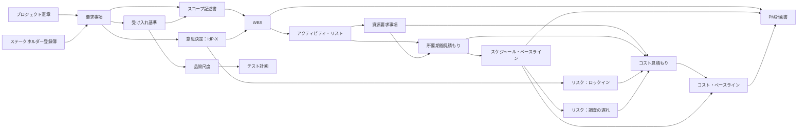

# PMBOKの文書を変更要求に合わせて更新する

日本語 | [English](pmbok.en.md)

PMBOKに沿ったプロジェクトでは、変更要求が承認されると、スコープ記述書、WBS、スケジュール、コスト、リスク登録簿などを更新する必要があります。
どの文書まで更新が必要かを手作業で追うと、もれが起きやすくなります。
このガイドでは、PMBOKの文書をAdaptraceで管理し、変更要求のたびに見直す文書をもれなく洗い出す方法を説明します。

- 対象は、Adaptrace v0.7の後の開発版です。v0.7にない `impact --order review`、`progress`、`list`、`conflicts`、`meeting`、`changes`、`resource` によるファイルの更新の検出を使います。キーとコマンドの正確な決まりは、[スキーマの仕様](../spec/schema.md) にあります
- パッケージは未公開です。この文書の `adaptrace` は、cloneしたリポジトリでの `bun src/cli.ts` と読み替えてください
- 文書の名前は、プロセスごとの入力と出力を一覧にしている「PMBOKガイド第6版」に合わせています
- 例は、[プロジェクトマネジメントでの使い方](project-management.md) と同じMFAの導入プロジェクトです。顧客から「SMSでもコードを受け取れるようにしてほしい」という変更要求が来た場面を扱います

## 全体の流れ

1. PMBOKの文書を、1つずつMarkdownの文書としてバンドルに置く
2. 文書どうしの依存関係を、上流から下流への向きでフロントマターに書く
3. 変更要求が来たら、`estimate` で影響を受ける文書の一覧を作り、変更管理委員会（CCB）の判断材料にする
4. 承認されたら、`impact --order review` が示す順に、上流の文書から更新する。変更が不要だった文書も、`verified` に見直したことを記録する
5. `progress` で、見直していない文書が残っていないことを確認する

## 1. 文書をバンドルに置く

この章の例をもとにしたテンプレートを、[examples/pmbok/](../../examples/pmbok/README.md) に置いています。作業（`tasks/`）は含めていません。
テンプレートでは、リスクを記入例の1件にまとめ、補助計画書と前提条件への依存関係を追加しています。
この章の図と、後の「見直す順番」の一覧では、補助計画書と前提条件を省略しています。テンプレートでの正確な順番は、`impact --order review` で確認できます。
最小構成（12件）と標準構成（28件）があります。コピーすれば、すぐに使い始められます。

### 1文書を1ファイルにする

Adaptraceは、バンドルの中のMarkdownファイルを1つの文書として扱います。依存関係も、ファイル単位で張ります。
そのため、PMBOKの文書は、原則として1つの文書を1つのファイルにします。

プロジェクトマネジメント計画書は、補助計画書とベースラインを別のファイルに分けます。
1つのファイルにまとめると、どれか1つの節が変わっただけで、計画書全体に依存しているすべての文書が見直しの対象になります。

フォルダ構成の例です。

```text
.adaptrace/
├── initiating/
│   ├── business-case.md              # ビジネス・ケース
│   ├── project-charter.md            # プロジェクト憲章
│   └── stakeholder-register.md       # ステークホルダー登録簿
├── assumptions/                      # 前提条件ログ（1件1ファイル）
├── plans/
│   ├── project-management-plan.md    # プロジェクトマネジメント計画書（全体）
│   ├── scope-management-plan.md      # スコープ・マネジメント計画書
│   ├── schedule-management-plan.md   # スケジュール・マネジメント計画書
│   ├── cost-management-plan.md       # コスト・マネジメント計画書
│   └── ...                           # 品質、資源、コミュニケーション、リスクなど
├── requirements/                     # 要求事項文書（1件1ファイル）
├── acceptance/                       # 受け入れ基準
├── decisions/                        # 意思決定
├── scope/
│   ├── scope-statement.md            # プロジェクト・スコープ記述書
│   └── wbs.md                        # WBSとWBS辞書
├── schedule/
│   ├── activity-list.md              # アクティビティ・リスト
│   ├── duration-estimates.md         # 所要期間見積もり
│   └── schedule-baseline.md          # スケジュール・ベースライン
├── resources/resource-requirements.md # 資源要求事項
├── cost/
│   ├── cost-estimates.md             # コスト見積もり
│   └── cost-baseline.md              # コスト・ベースライン
├── quality/
│   ├── quality-metrics.md            # 品質尺度
│   └── test-plan.md                  # テストと評価の文書
├── risks/                            # リスク登録簿（1件1ファイル）
├── milestones/                       # マイルストーン・リスト（1件1ファイル）
├── change-requests/                  # 変更要求（変更ログを兼ねる）
└── tasks/                            # 作業（Backlog.md と変換できる）
```

### 型を決める

`type` には、Adaptraceが用意している型を、当てはまる文書に使います。
当てはまる型がない文書は、PMBOKの英語の名前を `type` にします。表にない型を書いても、エラーにはなりません。

| PMBOKの文書 | `type` |
| --- | --- |
| 要求事項文書 | `Requirement`（1件1ファイル） |
| スコープ記述書の受け入れ基準 | `Acceptance` |
| リスク登録簿 | `Risk`（1件1ファイル） |
| マイルストーン・リスト | `Milestone`（1件1ファイル） |
| 変更要求、変更ログ | `Change Request`（1件1ファイル） |
| 会議の議事録 | `Meeting` |
| 意思決定の記録 | `Decision` |
| WBSのワーク・パッケージ、アクティビティ | `Task`（必要な場合だけ） |
| プロジェクト憲章 | `Project Charter` |
| 補助計画書 | `Management Plan` |
| スコープ記述書 | `Scope Statement` |
| WBSとWBS辞書 | `WBS` |
| スケジュール・ベースライン | `Schedule Baseline` |
| コスト見積もり | `Cost Estimates` |
| ステークホルダー登録簿 | `Stakeholder Register` |
| ビジネス・ケース | `Business Case` |
| プロジェクトマネジメント計画書（全体） | `Project Management Plan` |
| アクティビティ・リスト | `Activity List` |
| 資源要求事項 | `Resource Requirements` |
| 所要期間見積もり | `Duration Estimates` |
| コスト・ベースライン | `Cost Baseline` |
| 品質尺度 | `Quality Metrics` |
| テストと評価の文書 | `Test and Evaluation Documents` |

型の名前は、プロジェクトの中でそろえてください。同じ文書に `Cost Estimate` と `Cost Estimates` が混ざると、`estimate` の集計が分かれます。

### 登録簿とログは、1件1ファイルにする

リスク登録簿、要求事項文書、変更ログのように項目を並べる文書は、1件を1ファイルにします。
1件1ファイルにすると、「ロックインのリスク」だけが変わったときに、そのリスクに関わる文書だけが見直しの対象になります。
登録簿を1ファイルにまとめた場合は、どれか1件が変わるたびに、登録簿に依存しているすべての文書が対象になります。

課題ログ、前提条件ログ、教訓登録簿も、項目ごとに関係する文書が違う場合は、1件1ファイルにすると扱いやすくなります。
型は `Issue`、`Assumption`、`Lesson` のように、項目の名前にします。

### 要求事項トレーサビリティ・マトリックスは作らない

要求事項から受け入れ基準、WBS、テストまでのつながりは、Adaptraceの依存関係そのものです。
別の表として管理すると、依存関係と表の内容がずれていきます。
表が必要な場合は、`adaptrace graph` で図を、`adaptrace graph --format json` でデータを出力します。
要件ごとに、満たす文書と進み具合を表にするには、`adaptrace coverage --format markdown` を使います。満たす文書がない要件は `uncovered` と示されます。`--milestone` でマイルストーンを指定すると、そのマイルストーンの範囲に絞り、マイルストーンが待っている作業も示します。`coverage` は、v1.0.0の次のリリースから使えます。

### ExcelやMS Projectの文書は、代わりの文書を置く

Adaptraceが読むのはMarkdownファイルだけです。ExcelのWBSやMS Projectのスケジュールは、依存関係の相手にできません。
このような文書は、Markdownの「代わりの文書」をバンドルに置き、`resource` で実際のファイルを指します。

```markdown
---
type: Schedule Baseline
title: スケジュール・ベースライン
resource: ../../pm/schedule.mpp
generated: { by: human:sato, at: 2026-10-07T10:00:00+09:00 }
depends_on:
  - /schedule/duration-estimates.md
  - /milestones/release.md
---

# スケジュール・ベースライン

実体は [schedule.mpp](../../pm/schedule.mpp) です。ベースライン版は v3（2026-10-07 承認）です。
```

`adaptrace stale` を実行すると、記録がないことと、ファイルの今のSHA-256（内容から計算した値）が表示されます。

```text
schedule/schedule-baseline.md  updated 2026-10-07T10:00:00+09:00 (generated.at)
  no sha256 recorded for its file ../../pm/schedule.mpp (now 3f2a…c91e)
```

表示された値を、`resource_sha256` に記録します。

```yaml
resource: ../../pm/schedule.mpp
resource_sha256: 3f2a…c91e
```

これで、実際のファイルを更新すると、`stale` に「its file … changed」と表示されるようになります。
代わりの文書を見直したら、新しい値を記録し、内容を変えたら `generated` を、変えなかったら `verified` を更新します。
もとにしたファイルが複数あるときは、`sources` に並べ、それぞれに `sha256` を記録します。

```yaml
sources:
  - resource: ../../pm/wbs.xlsx
    sha256: 9b0d…41aa
  - resource: ../../pm/resource-plan.xlsx
    sha256: c4e7…08f2
```

## 2. 依存関係を張る

### 上流から下流へ張る

依存関係は、「作るときのインプット」を指すように張ります。
PMBOKのプロセスで、ある文書が別の文書のインプットになっていれば、下流の文書から上流の文書へ依存関係を張ります。

| キー | 使う場面 | 例 |
| --- | --- | --- |
| `derived_from` | 相手をもとに作った | スコープ記述書は、要求事項文書から作る |
| `depends_on` | 相手を前提にしている | コスト・ベースラインは、スケジュール・ベースラインを前提にする |
| `satisfies` | 相手を満たすための作業 | タスクは、要求事項を満たす |

この例のプロジェクトでは、次のように張っています。矢印は「変わったら、矢印の先を見直す」向きです。



フロントマターでは、矢印の先の文書に書きます。コスト見積もりなら、次のようになります。

```yaml
type: Cost Estimates
title: コスト見積もり
depends_on:
  - /resources/resource-requirements.md
  - /schedule/duration-estimates.md
  - /risks/idp-lockin.md
  - /risks/schedule-delay.md
  - /plans/cost-management-plan.md
```

プロジェクトマネジメント計画書は、補助計画書と3つのベースラインに `depends_on` を張ります。
こうすると、どれかが変わったときに、計画書全体の見直しも一覧に出ます。

### 循環させない

PMBOKの文書には、互いに影響し合うものがあります。
たとえば、スケジュールはリスクへの予備期間を含み、リスクはスケジュールをもとに洗い出します。
両方向に `depends_on` を張ると、循環依存になり、`validate` がエラーにします。

```text
error   risks/schedule-delay.md:6  cycle: risks/schedule-delay.md depends_on schedule/schedule-baseline.md, schedule/schedule-baseline.md depends_on risks/schedule-delay.md  [dependency-cycle]
```

循環を避けるには、次のどちらかにします。

- **向きを1つに決め、逆向きは本文のリンクにする。** この例では、リスクがスケジュールに依存します。スケジュールからリスクへは、本文で参照します
- **文書を分ける。** 「スケジュール予備」を別の文書にして、リスクに依存させます。スケジュール・ベースラインは、スケジュール予備に依存させます

迷ったときは、PMBOKの計画のプロセスで先に作る方を上流にします。

### 何でもつながない

関連があるだけの文書は、本文でリンクします。フロントマターに書くのは、相手が変わったら本当に見直す文書だけです。
つなぎすぎると、1つの変更要求で、ほとんどすべての文書が見直しの対象になります。

## 3. 変更要求を受け付ける

変更要求は、1件を1ファイルにします。`change-requests/` の文書の一覧が、そのまま変更ログになります。
変更ログを表にするには、`list` を使います。`--format markdown` の出力は、そのまま議事録やIssueに貼れます。
`--format csv` の出力をファイルに保存すると、Excelなどの表計算ソフトで開けます。例：`adaptrace list --type "Change Request" --format csv > change-log.csv`

```bash
adaptrace list --type "Change Request" --columns state,requested_by,received_at --sort received_at --format markdown
```

```markdown
---
type: Change Request
title: SMS でもコードを受け取れるようにする
state: submitted
requested_by: 顧客 A 社
received_at: 2026-11-18T10:00:00+09:00
generated: { by: human:sato, at: 2026-11-18T10:00:00+09:00 }
---

# SMS でもコードを受け取れるようにする
```

`received_at` には、変更要求を受け付けた日時を書きます。
後で `progress` が、起点の文書をこの変更要求に合わせて更新したかを判断するのに使います。
`generated.at` は `state` を変えるたびに更新することがありますが、`received_at` は変えません。ただし、起点の文書が `derived_from` でこの変更要求を指した後は、`generated` も変えません。起点の文書が古いと判定されるためです。古い変更要求をコピーして作るときは、`received_at` を書き直してください。

`state` の値は、プロジェクトで決めます。たとえば `submitted`（受付）、`approved`（承認）、`rejected`（却下）、`deferred`（保留）、`implemented`（反映済み）、`closed`（完了）です。

Claude Codeを使っている場合は、skill `adaptrace-change-request` を使えます。skillは、Claude Codeに作業の手順を教えるファイルです。このskillに依頼のメールや文面を渡すと、この節の手順を対話しながら進められます。変更要求の文書を作り、影響範囲と重なる変更要求を示します。skillの入手方法は、[既存のリポジトリに導入するガイド](adoption.md#claude-codeに取り込みを手伝ってもらう) と同じです。プラグインでインストールした場合は、すべてのskillがそろっています。フォルダをコピーする場合は、コマンドの `adaptrace-adopt` を `adaptrace-change-request` に置き換えてください。

### 起点の文書を決める

変更要求が直接変える文書を「起点」と呼びます。この例では、要求事項（`requirements/mfa.md`）が起点です。
SMSの送信事業者が新しいステークホルダーになるなら、ステークホルダー登録簿も起点にします。

起点は、変更要求の `changes` に書きます。

```yaml
changes:
  - /requirements/mfa.md
  - /initiating/stakeholder-register.md
```

`changes` は、承認の前から書いて構いません。見直しの連鎖は伝えないので、ほかの文書が古くなることはありません。
こう書いておくと、`estimate` に起点を渡さずに済みます（`adaptrace estimate --request change-requests/cr-002-sms.md`）。

### 重なる変更要求を確認する

大きなプロジェクトでは、互いに矛盾する変更要求を、別の担当者から別の経路で受けることがあります。
`conflicts` を実行すると、未決の変更要求のうち、影響範囲が重なる組を示します。

```bash
adaptrace conflicts --format markdown
```

同じ起点を変える組や、同じベースラインに届く組は、矛盾しているかもしれません。どちらかを承認する前に、まとめて協議してください。

`--llm "claude -p"` を付けると、組ごとに、両立できるか（`conflict`、`duplicate`、`compatible`、`unclear`）と、協議で決めるべき点をLLMに判定させます。
LLMの判定は、協議の材料です。決定ではありません。

### 協議の会議を準備する

重なる変更要求は、まず社内で方針を決め、次に顧客と相談します。`meeting` を使うと、会議ごとに、準備に使う材料を作れます。

次の例では、`cr-002-sms.md` と、メールのコードの廃止を求める別の変更要求 `cr-003-email.md` が重なっているとします。

```bash
adaptrace meeting change-requests/cr-002-sms.md change-requests/cr-003-email.md
adaptrace meeting change-requests/cr-002-sms.md change-requests/cr-003-email.md --audience customer
```

- 参加者の候補は、影響を受ける文書の担当者（`owner`）と、変更要求を出した人（`requested_by`）です
- 社内か顧客かは、ステークホルダーの文書の `side` だけで決めます。`owner` と `requested_by` には、その文書のパスを `/` から書きます（`requested_by: /stakeholders/a-corp.md`）
- 前の節の例のように `requested_by: 顧客 A 社` と名前だけを書いた場合、`meeting` は社内か顧客か分からない人として扱います。ステークホルダーの文書を作り、そのパスを書いてください
- 社内の会議に招く候補は、`side: internal` の文書で社内と分かる人だけです。名前だけの `owner` など、社内か顧客か分からない人は「招待の前に確認が必要」と示します。顧客を社内の会議に誤って呼ばないためです

```yaml
# stakeholders/a-corp.md
type: Stakeholder
title: 顧客A社 情報システム部
side: customer
role: 発注者の窓口
```

- 顧客との会議の材料には、社内の検討の詳細（影響を受ける文書、重なり、ベースライン、担当する文書の名前）を含めません
- `--llm "claude -p"` を付けると、協議で決めるべき点と、招集の文案も作ります
- `--write` を付けると、`Meeting` の下書きを `meetings/` に作ります。会議の後は、議事録を `extract` に渡して、方針の `Decision` を下書きします
- 日程調整と招待の送信は、Adaptraceでは行いません。連絡先もバンドルに書きません

### 影響を受ける文書を洗い出す

`estimate` に起点と変更要求を渡すと、影響を受ける文書を一覧にできます。起点は複数指定できます。

```bash
adaptrace estimate requirements/mfa.md --request change-requests/cr-002-sms.md --format markdown
```

```text
# Change estimate: `change-requests/cr-002-sms.md`

Starts from `requirements/mfa.md` and reaches 16 more documents. 17 documents in all: Requirement 1, Acceptance 1, Decision 1, Scope Statement 1, Task 1, Quality Metrics 1, Risk 2, WBS 1, Cost Estimates 1, Project Management Plan 1, Test and Evaluation Documents 1, Activity List 1, Cost Baseline 1, Resource Requirements 1, Duration Estimates 1, Schedule Baseline 1.

## Documents

| Document | Type | State | Owner | Due | Via |
| --- | --- | --- | --- | --- | --- |
| ログインに MFA を入れる (`requirements/mfa.md`) | Requirement |  |  |  | (changed) |
| MFA の受け入れ基準 (`acceptance/mfa.md`) | Acceptance |  |  |  | derived_from -> requirements/mfa.md |
| 認証基盤に IdP-X を使う (`decisions/auth-provider.md`) | Decision |  |  |  | depends_on -> requirements/mfa.md |
| プロジェクト・スコープ記述書 (`scope/scope-statement.md`) | Scope Statement |  |  |  | derived_from -> requirements/mfa.md |
...
| コスト・ベースライン (`cost/cost-baseline.md`) | Cost Baseline |  |  |  | depends_on -> cost/cost-estimates.md |
| スケジュール・ベースライン (`schedule/schedule-baseline.md`) | Schedule Baseline |  |  |  | depends_on -> schedule/duration-estimates.md |
| SDK 調査の遅れ (`risks/schedule-delay.md`) | Risk |  |  |  | depends_on -> schedule/schedule-baseline.md |
```

- 3つのベースラインのどれが影響を受けるかが分かります。ベースラインの変更は、CCBの承認が必要な判断材料になります
- 出力を変更要求の文書の本文に貼っておくと、承認したときの影響範囲が記録に残ります
- `--llm "claude -p"` を付けると、文書ごとの工数の目安も出ます。詳しくは [プロジェクトマネジメントでの使い方](project-management.md) を参照してください

## 4. 承認されたら、上流から順に更新する

承認されたら、変更要求を `state: approved` にし、起点の文書を更新します。

Claude Codeを使っている場合は、skill `adaptrace-change-decision` で、承認、却下、保留の判断を記録できます。`state` を変え、変更要求の本文に、判断した日、判断した人、理由を書きます。重なっていた未決の変更要求と、次の手順も示します。複数の変更要求の判断を、まとめて記録することもできます。このskillは、v1.0.0の次のリリースから使えます。skillの入手方法は、[既存のリポジトリに導入するガイド](adoption.md#claude-codeに取り込みを手伝ってもらう) と同じです。プラグインでインストールした場合は、すべてのskillがそろっています。フォルダをコピーする場合は、コマンドの `adaptrace-adopt` を `adaptrace-change-decision` に置き換えてください。

起点の文書には、`derived_from` で変更要求を追加し、`generated.at` を今の日時にします。

```yaml
generated: { by: human:sato, at: 2026-11-20T10:00:00+09:00 }
derived_from:
  - /initiating/project-charter.md
  - /initiating/stakeholder-register.md
  - /change-requests/cr-002-sms.md
```

続いて、影響を受ける文書を見直します。

Claude Codeを使っている場合は、skill `adaptrace-review` で、この節の手順を対話しながら進められます。起点の文書の更新から、ステップごとの見直し、変更要求を反映済みにするまでを支援します。skillの入手方法は、[既存のリポジトリに導入するガイド](adoption.md#claude-codeに取り込みを手伝ってもらう) と同じです。プラグインでインストールした場合は、すべてのskillがそろっています。フォルダをコピーする場合は、コマンドの `adaptrace-adopt` を `adaptrace-review` に置き換えてください。

### 見直す順番

**上流の文書から順に見直してください。** 下流の文書を先に見直すと、後で上流を更新したときに、もう一度見直すことになります。

この例のプロジェクトで、`stale` に出た文書から順に見直すと、16件の文書に対して24回の見直しが必要でした。コスト見積もりとコスト・ベースラインは3回、PM計画書は4回見直すことになります。
上流から順に見直せば、1件につき1回で済みます。

`impact` に `--order review` を付けると、上流からの順に並べて表示します。

```bash
adaptrace impact change-requests/cr-002-sms.md --order review
```

各行の先頭の数字は、見直す順番の「ステップ」です。ステップ1から順に見直します。
同じステップの文書は互いに依存していないので、どの順に見直しても構いません。担当者で手分けすることもできます。

PMBOKの文書なら、計画のプロセスの順がおおむね上流からの順になります。

1. 要求事項、受け入れ基準、意思決定
2. スコープ記述書、WBS
3. アクティビティ・リスト、資源要求事項、所要期間見積もり
4. スケジュール・ベースライン
5. リスク登録簿
6. コスト見積もり、コスト・ベースライン
7. 品質尺度、テストと評価の文書
8. プロジェクトマネジメント計画書
9. タスク

### 変更が不要だった文書も記録する

見直した結果、内容を変えなくてよい文書もあります。その場合は、`generated` を変えずに、`verified` に見直した人と日時を記録します。

```yaml
generated: { by: human:sato, at: 2026-10-07T10:00:00+09:00 }   # 内容を最後に変えた日時。変えない
verified: { by: human:sato, at: 2026-11-20T15:00:00+09:00 }    # 見直した日時
```

`generated` を更新するのは、内容を変えたときだけです。こうすると、ベースラインを変えたのか、見直しただけなのかが、フロントマターから分かります。
また、見直しただけの文書に依存している文書は、見直しの対象になりません。内容が変わっていないからです。
これが「この変更要求を受けて見直した」という記録になります。記録しないと、`stale`、`impact`、`progress` に出たままになります。

`assess` を使うと、文書ごとに見直しが必要かどうかをLLMに判定させ、更新案を作らせることもできます。

```bash
adaptrace assess requirements/mfa.md --llm "claude -p"
```

`assess` は、直接の依存元だけを判定します。上流から順に、更新した文書ごとに実行してください。
`assess` はファイルを書き換えません。更新案を確認してから、人が適用します。

## 5. もれがないことを確認する

`progress` に変更要求を渡すと、影響を受ける文書ごとに、見直しの状況を上流からの順に表示します。

```bash
adaptrace progress change-requests/cr-002-sms.md
```

各文書の状況は、次の3つのどれかです。

| 表示 | 意味 | すること |
| --- | --- | --- |
| `reviewed` | 見直し済み | なし |
| `to review` | 上流の文書は見直し済みだが、この文書の方が古い | 今すぐ見直す |
| `waiting` | 上流に、まだ見直していない文書がある | 上流の文書を先に見直す |

最後の行に、見直し済みの件数が出ます。**すべて `reviewed` になれば、もれはありません。**

- 起点の文書は、変更要求の `received_at` より新しければ、更新したものとみなします。`derived_from` で変更要求を追加しても、`generated` か `verified` を更新し忘れると `to review` になります
- 下流の文書は、上流の文書がすべて見直し済みになるまで `waiting` のままです。先に見直しても、上流が後から更新されれば、もう一度 `to review` になります
- すべて見直し済みになるまで、CIのチェックは失敗します。変更要求ごとのPRで実行すると、見直しのもれを防げます。ただし、どの文書も変更要求を指していないときは成功します
- `--format markdown` の出力は、そのまま変更要求の文書の本文やIssueに貼れます

`progress` が見るのは、この変更要求の影響範囲の中だけです。
影響範囲の外の文書が更新されて古くなった文書は、これまでどおり `stale` で確認します。

```bash
adaptrace stale
```

確認が終わったら、変更要求を `state: implemented` にします。`generated` と `received_at` は変えないでください。起点の文書は `derived_from` で変更要求を指しているので、変更要求の `generated` を新しくすると、`stale` が起点を古いと示します。反映を終えた日時は、`log.md` に記録します。MCPのツール `propose_update` は、更新案の `generated` を今の日時にします。変更要求の `state` を変えるときは、その更新案の `generated` と `timestamp` の行を元の状態に戻してから適用してください。
文書の変更はgitのコミットにまとめ、PRでレビューします。いつ、誰が、どの文書を変えたかが、gitの履歴に残ります。

## 今の機能でできないこと

次のことは、まだできません。それぞれ、記載の方法で対応してください。

| できないこと | 対応する方法 |
| --- | --- |
| 文書の節ごとに依存関係を張る | 文書を分ける |
| 互いに影響し合う文書を、両方向でつなぐ | 向きを1つに決めるか、文書を分ける |
